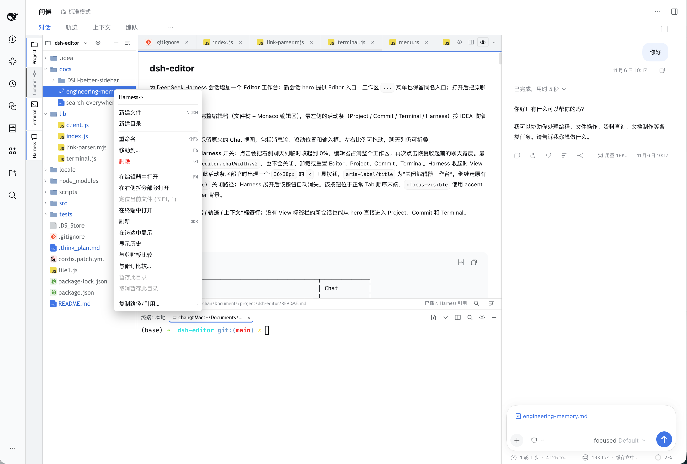
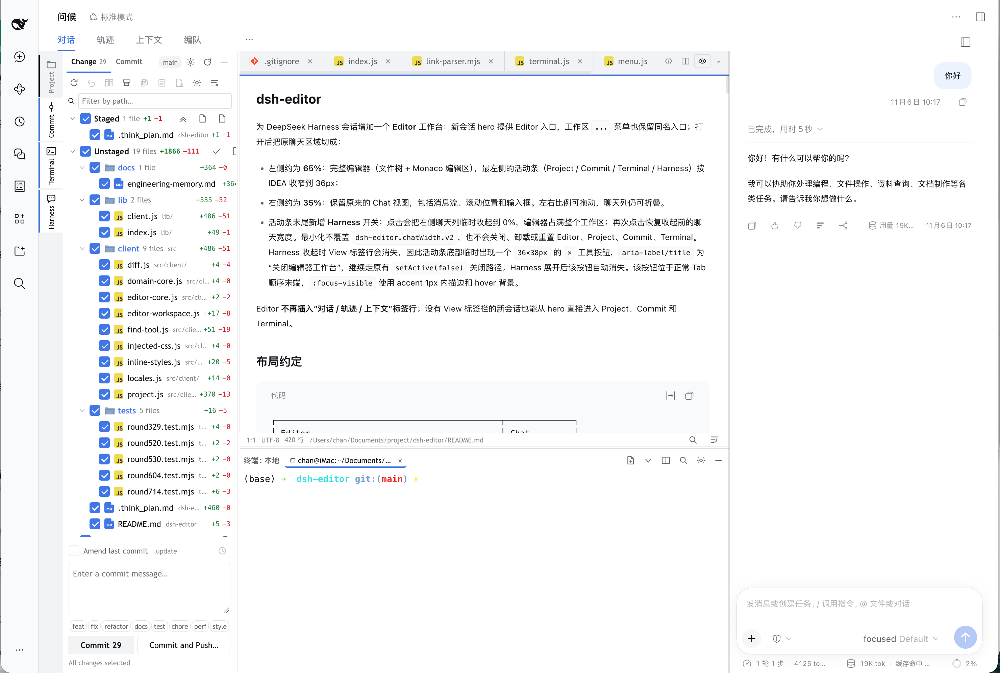
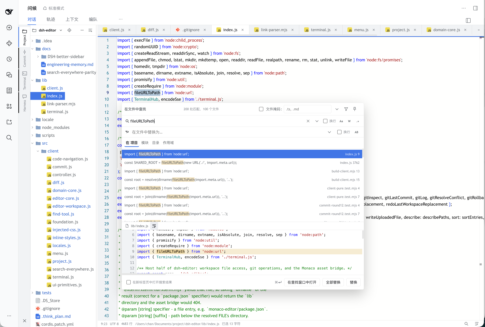

# dsh-editor

**在 DeepSeek Harness 中提供 IDE 式 Editor 工作台，对齐 IDEA 的 Project、Commit、Terminal、搜索与替换体验。**

下面截图是当前实际运行效果：编辑器与 Harness Chat 并排工作，Project 文件树、Monaco、终端、Commit 和 Find in Files 都在同一工作台内完成。

## 功能演示

### 编辑器工作台



Project 文件树、Monaco 编辑区、底部 Terminal 与右侧 Harness Chat 同时工作；支持文件 tab、图片预览、Markdown 预览、Harness 引用、目录拖拽和操作系统文件上传。

### Commit 工具窗口



按 IDEA changelist 语义展示 staged / unstaged / unversioned 文件，支持目录树、批量选择、暂存/取消暂存、提交、提交并推送、Amend、差异预览和提交历史。

### Find in Files 与替换



提供 IDEA 风格 Search Everywhere、持久 Find 工具窗、Directory/Scope 搜索、File mask、Preview、单处 Replace 与 Replace All，并保留搜索历史和可撤销替换。

为 DeepSeek Harness 会话增加一个 **Editor** 工作台：新会话 hero 提供 Editor 入口，工作区 `...` 菜单也保留同名入口；打开后把原聊天区域切成：

- 左侧约为 **65%**：完整编辑器（文件树 + Monaco 编辑区），最左侧的活动条（Project / Commit / Terminal / Harness）按 IDEA 收窄到 36px；
- 右侧约为 **35%**：保留原来的 Chat 视图，包括消息流、滚动位置和输入框。左右比例可拖动，聊天列仍可折叠。
- 活动条末尾新增 **Harness** 开关：点击会把右侧聊天列临时收起到 0%，编辑器占满整个工作区；再次点击恢复收起前的聊天宽度。最小化不覆盖 `dsh-editor.chatWidth.v2`，也不会关闭、卸载或重置 Editor、Project、Commit、Terminal。Harness 收起时 View 标签行会消失，因此活动条底部临时出现一个 `36×38px` 的 `×` 工具按钮，`aria-label/title` 为“关闭编辑器工作台”，继续走原有 `setActive(false)` 关闭路径；Harness 展开后该按钮自动消失。该按钮位于正常 Tab 顺序末端，`:focus-visible` 使用 accent 1px 内描边和 hover 背景。

Editor **不再插入“对话 / 轨迹 / 上下文”标签行**；没有 View 标签栏的新会话也能从 hero 直接进入 Project、Commit 和 Terminal。

## 布局约定

```
┌──────────────────────────────────────────────┬──────────────┐
│ Editor                                       │ Chat         │
│ ┌──────────┬───────────────────────────────┐ │              │
│ │ 文件树    │ Monaco 编辑区                  │ │  消息流      │
│ │ (约1/4)  │ (约3/4)                        │ │              │
│ │          │                               │ │              │
│ └──────────┴───────────────────────────────┘ │  输入框      │
└──────────────────────────────────────────────┴──────────────┘
```

- View 标签栏最右端是一个**编辑器显示/隐藏图标按钮**，**按真实标签高度对齐**；它不是 Editor 标签，也不参与 View 切换。未打开时点击显示 Editor，打开后点击关闭 Editor，回到完整对话。
- 外层：编辑器约 65%，Chat 约 35%；Chat 那一栏的**左边缘可拖动**（28%–44%），拖动时显示实时百分比，松手后写入 `localStorage`，下次打开时恢复。点“对话 / 轨迹 / 上下文”等真实 View 标签也会关闭分屏并恢复完整聊天区。
- 编辑器内部：文件树占 25%，编辑区占 75%。编辑区**没有**自己的标题/保存/刷新条：Project 的工具栏已经贴在最上方，打开的文件由标签页与面包屑表示，保存走 `⌘/Ctrl+S`（全部保存 `⌥⌘S`），刷新由宿主文件监听自动完成（Project 工具栏里另有手动「刷新」）。多出来的那一行只会白占 38px 高度。
- 分屏时聊天区在底部预留输入框的高度（`padding-bottom: 132px`），最后一条内容（如「深度搜索中，用时 N 秒」）不会再被输入框盖住；聊天区**默认定位到最新消息**（否则长对话从顶部开始，最新内容在屏幕外，向上滚动看起来毫无反应），用户手动上滚后不再强制跟随，此时输入框上方出现「↓ N」徽标（N 是上滚期间到达的新消息数，超过 99 显示 `99+`），点它回到最新消息（到底部后徽标自动隐藏、计数清零）；输入框的占位层不再拦截点击（`pointer-events: none`），点输入框即可聚焦并输入；聊天列保留完整高度链（各层 `height: 100%`），滚动交给宿主的 `.viewArea`；输入条改为**绝对定位贴聊天列底部**（`position: absolute; bottom: 0`），不再继承宿主的 `sticky` —— 后者在对话超过一屏时会把输入框粘到区域顶部（实测 y=31，跑到编辑器上），表现为「输入框根本没显示」；横向滚动体本身保持 `pointer-events: none`（它横跨整个会话区），由聊天列子树重新开启事件，避免吞掉编辑器与文件树的点击。
- 新会话 hero 的 `conversation.hero.options` 槽会出现一个图标式 **Editor** 入口；它调用与工作区菜单完全相同的激活逻辑。宿主重渲染 hero 后会自动补回，打开后图标保持按下态，再点一次退出工作台。
- 工作区行右侧 `...` 菜单（宿主渲染）会在「重命名」之前注入一个 **Editor** 项，点它打开同一工作台，并把 Project / Commit 绑定到**被点击的那个工作区**；打开时先收起宿主左侧的工作区/会话列表栏，只保留 56px 图标轨道，把原 280px 宽度让给 Project 文件树、编辑器与 Chat；侧栏本来已收起时保持原状，不会反向点开。即使该工作区还没有活动会话，也不会退化成空 `Workspace`。宿主服务按请求惰性解析，workspace registry 晚于插件就绪时也不需要再次重启宿主。随后会把当前 View 切回 Chat，因此右侧始终是原始聊天窗口。注入项在宿主重渲染菜单后自动补回；图标取宿主 sprite 中真实存在的分栏图标（缺失时保留原图标，不留空白）。会话行 `...` 菜单（`置顶/重命名/分叉/归档`）不会被注入。键盘可用：菜单内 `↑` 从首项走到 Editor、`↓` 走回，`Enter` 等同点击。Editor 的 React root 挂在 `main.conversation` 的稳定布局父节点上，不进入会随会话和 View 重建的 Chat body；Chat body 替换时只更新 fixed overlay 的测量矩形。若宿主替换了布局父节点，插件只把现有 host 节点重新挂到新父节点，不销毁 React root、Monaco model、xterm 或文件树；因此后台刷新、搜索弹框状态更新和聊天重渲染不会触发整块 Editor 卸载。若工作台内部仍发生渲染异常，局部错误边界会保留右侧 Chat，并在左侧显示“编辑器加载失败 / 重新加载编辑器”，不再静默变成空白区域。
- Harness 侧栏的 **Add workspace** 按运行面分流：DSH App（根节点带 `data-platform`）保留宿主原生目录 chooser；Web 页面改用共享 `WorkspaceDirectoryPicker`。目录弹框默认定位 `~` home，并以 `~/...` 展示 home 下路径；路径行右侧提供 `→`、刷新和 Show hidden，不再为隐藏目录单独占一行。路径输入提供目录自动完成下拉，支持鼠标和上下键/Enter 选择；`→` 按输入路径在当前树中逐级展开并聚焦目标目录一级子目录，root 外路径则以目标为新根。选择目录后调用宿主 `workspaces.create({ path })` 登记工作区。目录枚举优先复用宿主公开 `uiWorkspace.listDirectory`；当当前 profile 只组合 native picker、返回 `directory-picker/unavailable` 时，回退到 dsh-editor 的只读目录桥，其他权限或业务错误不会被兼容逻辑吞掉。provider 选择在首次探测后缓存，后续打开不会再重复发起不可用的公开能力探测。目录弹框复用 Project 的 `FileTreeView` 以及 Find/Search Everywhere 的 `FloatingToolPopup` 遮罩、拖动和八向缩放；modal 模式还复用共享 `focus-trap.ts` 的可见焦点收集、Tab/Shift+Tab 闭环、Escape 与 opener 恢复。Find、Search Everywhere、QuickOpen 和目录选择器不再各自维护 focusable selector 或取模算法。浮动弹框的边框、圆角、背景、阴影、拖动、缩放和遮罩统一由 `FloatingToolPopup` 拥有。Editor 会读取宿主当前 `data-conversation-session` 对应的 Workspace；只有真实 Workspace picker 菜单在标题唯一时立即切换 Editor，其他同名菜单不会误触发，重复标题仍由 session 映射兜底；Project、Commit、Terminal 会重建到新 Workspace，隐藏后再打开也不会残留旧 root；Project rows 会等待当前 root 的展开状态恢复后再显示，避免切换后先折叠再展开；workspace remount 会恢复当前 Project/Commit 工具窗焦点，并抑制 Monaco 在恢复窗口内抢焦；同一 Workspace 内切换 Session 只更新映射，不卸载 Monaco、Project tree 或 xterm。Commit 草稿按 workspace root 隔离，Terminal PTY 和 profile 按 workspace scope 隔离，切换往返不会串到其他项目。Web 目录桥只返回目录、不读取文件内容；Host 旧进程找不到该桥时，界面提示重启 Harness，而不是显示原始 HTTP 404。
- 运行错误诊断仍写入 `$DSH_HOME/logs/dsh-editor-diagnostics.jsonl`（desktop 默认通常为 `~/.dsh/logs/dsh-editor-diagnostics.jsonl`）。只记录 `react-render-error / window-error / unhandled-rejection` 等低频技术事件，并附带最多 12 个不含输入正文的最近交互动作；周期性 host 健康检查、`host-unhealthy / host-rebuild / host-recovered` 和 700ms 重建 watchdog 已在稳定宿主迁移后移除。Monaco 在 diff/editor dispose 或 restore view state 时产生的内部 `Canceled / Canceled: Canceled` 属于无主取消 Promise：只有 stack 明确来自 Monaco 的 `editor.main.js` 时才被 `unhandledrejection.preventDefault()` 消费，既不污染控制台，也不写入诊断；其他异常仍完整上报。宿主日志接口有 64 KiB 请求上限和最多 20 条/批限制，客户端只保留最近 50 条事件。
- 点击“对话 / 轨迹 / 上下文”等真实视图标签会关闭分栏，恢复原来的单视图布局。

## Terminal（IDEA 式左边 Dock）

- 左侧 Activity Stripe 的 **Terminal** 按钮、`Alt+F12` 或编辑器内的 `Ctrl+Shift+\`` 开关底部 Dock。从 Activity Stripe 打开时会在 pointerdown 阶段记录当前 Project tree、Commit Changes 或编辑器 origin；无论随后用按钮还是快捷键关闭，都优先回到该 origin，只有 origin 已卸载时才回落到当前编辑器/Diff。
- 标签栏最左侧有固定工具窗口标题“终端: 本地” / `Terminal: Local`，不随 shell OSC 标题或 CWD 改变；编辑器容器窄于 440px 时标题自动隐藏，把空间留给 active tab、`»` 和工具按钮。
- 真实 PTY（`ctx.subprocess.spawnTerminal`），cwd 为当前会话工作区，跟随主题配色。
- 多标签：`⌘T` / `+` 新建、`×` 关闭；关闭最后一个标签即收起 Dock。每个 Session 最多保留 6 个 shell，达到上限时状态栏提示「请先关闭一个再新建」，而不是照抄宿主的英文报错。
- `+` 旁箭头选择已安装 shell（zsh / bash / fish / pwsh / sh）；双击标签标题重命名。
- 工具栏直接保留 `New Tab / New Predefined Session / Split Terminal / Find / Options / Hide`；预定义会话入口列出宿主可用 shell，但不伪造 IDEA 专属配置对象。清屏、**Increase Font Size / Decrease Font Size / Reset Font Size** 和刷新收进 IDEA 式 `Options` 菜单；字号范围 8–24pt、默认 12pt，偏好持久化。`⌘K` 仍是清屏直达快捷键。
- 屏幕右键按 IDEA 顺序组织：**查找 `⌘F` / 在命令历史中搜索 `⌃R` / 中断命令 / 清除命令行 / 新建终端 / 关闭终端 `⌘W` / 复制 / 复制命令块 / 粘贴 / 从历史粘贴… / 全选 / 选择上一命令块 `⌘↑` / 选择命令行 `⌘↓` / 选择上方命令块 / 选择下方命令块 / 向上扩展命令块选择 / 向下扩展命令块选择 / 清屏（保留滚动缓冲）`⌘K` / 清屏并清除滚动缓冲 / 上翻一页 `⇧PageUp` / 下翻一页 `⇧PageDown` / 上移一行 / 下移一行 / 在右侧分屏 / 移动到编辑器 / 将焦点切换到编辑器**。`Copy Block` 与无选区时的 `⌘C` 复用 `Select Last Block` 的连续输出范围并复制；`Select Last Block` 从当前逻辑 prompt 之上跳过空行，选择最近一段连续非空输出；`Select Prompt` 结合 xterm `isWrapped` 选中完整的多行逻辑 prompt；`Select Block Above/Below` 在当前 selection 的连续非空块边界上跳到相邻块，`Expand Block Selection Above/Below` 把当前块与相邻块合并选择，相邻搜索不会跨过当前 prompt。已有 block selection 且 Terminal Find 关闭时，`↑/↓` 在相邻块之间移动，`⇧↑/⇧↓` 扩展 block selection；没有 block selection 时 `↑/↓` 继续交给 shell history，不改变 PTY 输入。鼠标右键会先保存 xterm selection position，再打开菜单，避免 right-mousedown 清空 selection 后相邻块动作失效。这些动作都不解析 shell 私有 prompt 序列，也不另造命令块执行器。`Meta/Ctrl+↑/↓` 分别执行 Select Last Block / Select Prompt。`Interrupt Command` 向聚焦 pane 发送 `Ctrl+C`，`Clear Command Prompt` 发送 `Ctrl+U` 只清当前 shell 命令行，不清屏也不丢 scrollback；shell 已退出时两项禁用。`⌘W` 只关闭当前持焦 pane，最后一个 shell 关闭后 Terminal 工具窗口收起；关闭操作先在本地移除 tab/split，再把 host close 作为 best-effort，不因 host 响应慢而让已关闭终端长期滞留；若关闭的是持焦 pane，焦点会回到幸存 xterm。命令历史搜索向 shell 发送 IDEA 的 `Control+R`，复用 readline 的 reverse-i-search，不在插件内重复维护历史；粘贴历史只在当前 TerminalPanel 内存中保留最近 10 条并去重置顶，换行在菜单里显示为 `↵`，不会把剪贴板内容写进 localStorage，空历史时入口保持可见但禁用；两个清屏动作的名字不再靠括号区分；标签右键：重命名、**复制终端（沿用当前目录）**、**向左/向右移动标签**、**复制目录路径**、**打开此目录的 README**（目录取 shell 通过 `OSC 7` 上报的当前目录，`cd` 后「复制目录路径 / 在访达中显示 / 打开 README」都跟着走；`cd` 到工作区**之外**（如 `/tmp`）时「在访达中显示」按绝对路径打开该目录，不再静默回落到工作区根；目录已被删除时提示「目录已不存在：<路径>」而不是把宿主英文原样抛给用户；shell 未配置 OSC 7 时回落到终端**启动时**的目录；该目录没有 README 时置灰）、**在访达中显示**（打开该 shell 的工作目录；目录在工作区外时回落到工作区根）、关闭、关闭其他。首/末标签的左右移动、单标签时的“关闭其他”、达到 6 个 shell 上限时的“复制终端”、没有关闭历史时的“重新打开”都保持可见但禁用，避免菜单项在边缘或状态不可用时忽然消失。分屏时右键 tab 先判定该 tab 属于左 pane 还是右侧 split pane：右键右侧 split tab 只把键盘焦点交给右 pane，不会把它重新设为左侧 activeId，也不会出现重复的“向右拆分”；因此仅打开右侧 tab 菜单不会触发 split guard 自动收起分屏。
- `Close Other Terminals` 同样先在本地只保留目标 tab、收起 split、清理颜色，并把焦点交还目标 xterm；被关闭的 terminal 全部写入 Reopen Closed Terminal 历史，host close 仅作为后台 best-effort。
- Terminal close 按 id 记录进行中的关闭；同一 tab 的重复 Close / 连续菜单点击只会发出一次 host close，避免重复 PTY close 和竞态。
- Terminal tab 重排响应带 request generation；连续拖拽或 Move Tab Left/Right 时，较旧的 host reorder 响应不能覆盖较新的本地 tab 顺序。
- 关闭 active dock terminal 时，下一 active tab 优先选择“未移入编辑器且不等于 splitId”的可见 dock terminal，避免无关 split 被错误收起或 active 指向不可见 terminal。
- Reopen Closed Terminal 会把关闭时保存的目录作为新 PTY 的 `startPath`，即使原 shell 已卸载而回退默认 shell，也仍从关闭前目录启动。
- Terminal host list 刷新时会与 editor placements 协调：剪除已不存在的 editorId，并保证 dock active 不指向已移入编辑器的 terminal。
- 标签跟随 shell 的 OSC 标题；手动重命名后不再被自动标题覆盖。
  - 标签可拖拽重排，顺序由宿主保存，刷新后保持；标签栏放不下时按 IDEA 收起 `»` 下拉，被选中的终端永远留在可见区，不会被藏进菜单；下拉条目带与标签栏相同的颜色条。可见标签使用 `tablist/tab` 语义和 roving `tabIndex`：Tab 进入活动标签后，`←/→` 切换可见标签、`Home/End` 跳首尾、`Enter/Space` 激活、`Shift+F10` / ContextMenu 打开当前标签菜单；右键 tab 或 `»` 时先把它们设为菜单 opener，Esc/关闭菜单后焦点回到同一 tab/按钮，而不是旧控件。末标签按 `→` 进入 `»`，`»` 上按 `←` 返回标签。`»` 自身也支持 Enter、Shift+F10 与 ContextMenu 打开同一隐藏标签菜单，菜单右缘与按钮对齐；选择隐藏终端后焦点落到新激活的可见 tab。每个 tab 的辅助技术名称固定为终端标题，不包含关闭 `×`；拖拽 start/end 会把焦点留在被拖标签，真实重排后方向键和菜单上下文仍指向该 tab。

- 查找栏里 `⌘G` / `⇧⌘G` 走下一个 / 上一个匹配（原来只有按钮，键盘到计数就断了）。
- `⌘/Ctrl+F` 打开终端查找栏，**上次的查询会保留**并重新统计命中数（再次按 ⌘F 不会覆盖已打开查找栏里的内容）。
- 查找栏显示 `n/total` 与上/下一个；`⌘1`–`⌘9` 直选标签，`⌥←/→` 循环切换，`⌘K` 清空聚焦侧屏幕（不结束 shell）。分屏时 `⌘1`–`⌘9`、`⌥←/→` 和 Terminal Find 都作用于**聚焦的那一侧**：Find 的计数、Enter、上/下一个及关闭后的焦点始终回到打开它的 pane；右 pane 消失时安全回退左 pane。终端 pane 持焦时 `⌘F` 只打开 Terminal Find，Project speed search 会主动让位。若选中的是另一侧正在用的终端，两侧会交换而不是把分屏收掉。
- 标签可拖到另一分屏：拖到右格即成为右格终端，把右格自己的标签拖回左格等于取消分屏。
- **新 shell 按屏幕真实宽度启动**：PTY 原来固定 `80×24`，而 xterm 实际适配成 77 列；zsh 的 `PROMPT_SP` 把 `%` 标记补齐到 PTY 宽度再用退格擦掉，宽度对不上时那行会折行，于是 `%` 卡在第一行、提示符掉到第二行。现在先用一个不可见的 xterm（`MeasuringScreen`）量出真实 `cols×rows` 再 spawn；`+` 点得比测量快时最多等 400ms，xterm 加载失败仍回落 `80×24`。
- **`+` 不再"卡死"**：`generation` 那个 effect 的依赖里带着 `createTerminal`，而它的依赖里又有工作区内联传入的回调，身份几乎每次渲染都变 → 每个渲染周期都 spawn 一个 shell（实测点击后 `op:"create"` 连续刷屏）。改成一发式 effect 只依赖 `generation`、经 `createTerminalRef` 读最新回调；自动开首个 shell 的 effect 同样去掉这两个依赖，靠 `openedRef` 保证幂等。
- `⌘C` 复制选区、`⌘V` 粘贴（原有 `⌘⇧C` / `⌘⇧V` 继续保留）；`Ctrl+C` 仍发送 SIGINT，不会被当成复制。多行粘贴前按 IDEA 的方式确认"要粘贴 N 行到终端吗？"；`⌘A` 全选缓冲、`⇧F6` 重命名聚焦标签（右键菜单印的键都能真按）。
- Terminal 屏幕与标签菜单提供 IDEA 的 **Switch Focus To Editor**：Dock 保持打开，普通工作区聚焦 Monaco；当前显示 diff 时改为聚焦修改侧 Monaco，不会落到隐藏的主编辑器。菜单项使用 `restoreFocus:false`，ContextMenu 关闭时不会把焦点抢回终端。
- 终端里的 URL 与工作区文件路径（含 `path:line:column`）自动下划线；⌘/Ctrl+点击直接在编辑器打开并定位到该行。
- 拖拽 Dock 上沿可调整高度。**底部不再有状态行**（原来那条 `路径 90×10` 白占 20px，路径本来就印在标签的 `title` 里、列×行也没人看）；只有出错时才会出现一条错误条。
- **只有一行标题**：原来"Terminal –"那行连同它的 `–` 收起按钮一起去掉了，收起按钮挪到**标签栏最右端**（刷新按钮右边），点它就收 Dock，`onRequestClose` 仍由工具窗口持有。窄到 440px 时那一排工具按钮仍全在条内，没有溢出。
- 分屏：工具栏分屏按钮（或标签右键"在右侧分屏中打开"）把 Dock 拆成左右两格；只有一个终端时会自动在右侧新建一个。右侧格子自带终端下拉框，可换绑任意其他标签。
- 分屏宽度可拖拽（20%–80%），拖到中间 3 个百分点内会**吸附到 50/50**（IDEA 分隔条的吸附手感），双击分隔条回到 50/50；比例写入 `localStorage` 并在刷新后恢复；被点击的一侧带 IDEA 式聚焦描边，取消分屏时保留聚焦的那一侧，并把键盘焦点交还该终端 xterm，而不是停在工具栏按钮。
- 折叠面板、切换工具窗口、重绘都不会结束 shell：进程与屏幕缓冲由宿主 `TerminalHub` 持有，重新打开会回放当前屏幕。
- **移动到编辑器（Move to Editor）**：标签右键该动作把 shell 从 Dock 变成**编辑区**里的一个终端页，
  占满整个代码区（带一条细工具栏与「移回终端 Dock」按钮）。移过去的是**同一个 PTY**——实测移动作完后
  在其中输入 `echo` 仍有输出，说明不是重开了一个 shell；Dock 会立即选择剩余标签或清空活动屏，绝不继续渲染
  同一个 PTY 的第二份 xterm。放置按 Session/workspace 写进 `localStorage`，**刷新后编辑区终端会自己回来
  并且仍是活的**（宿主持有进程，页面只负责渲染）。「移回终端 Dock」即使 Dock 当前关闭也会直接恢复放置、
  打开 Dock 并激活该标签；有分屏绑在该终端上时先解绑。
- **切换工具窗口不再收起 Dock**（IDEA 的 Dock 是常驻的）：点 Commit 看 diff 时终端还在原处，shell 输出不会因为切了一下面板就被滚走。
- `Alt+1` / `Alt+2` / `Alt+3` 分别激活 Project / Commit / Terminal（IDEA 的工具窗口键）：工具窗口隐藏时打开并聚焦；已显示但焦点在编辑器时不收起，只把键盘交给对应工具窗口；只有对应工具窗口已持焦时再次按键才收起并把焦点还给当前编辑器或**仍可见的 Commit Diff modified editor**。`Alt+F12` 与 `Ctrl+Shift+\`` 复用同一 Terminal 激活语义，不会因为重新打开或聚焦而新建 shell；从终端内关闭时，焦点回到按下快捷键前的编辑器、Project 树或 Commit 差异。
- 宿主侧路由：`POST /api/dsh-editor/terminal`（list/create/write/resize/rename/close）、`GET /api/dsh-editor/terminal/stream`（SSE）、`/api/dsh-editor/xterm/*`（xterm ESM 资源）。
- xterm 以动态 `import()` 加载 ESM 构建：Monaco 会注册全局 AMD `define`，UMD 版本会被 AMD 拦截。

## Commit（IDEA changelist 语义）

- 更改按 **已暂存 / 未暂存 / 未纳入版本控制** 三组展示，目录树可折叠；勾选决定提交内容。列表上方有独立过滤框（`⌘F` 在 Changes 内聚焦并全选，按路径过滤，Esc 清空，`×` 一键清空），**只收窄显示，不改变勾选**——否则输入一个字就会静默改变下一次提交的内容。
- Changes 操作条按 IDEA 暂存区工具条提供 **暂存所有已跟踪文件**：暂存全部工作区侧改动但不碰 `??` 文件；`MM` 路径会把较新的工作区内容写入索引，而不是因索引侧已有改动被跳过。Commit 选项另提供 **全部暂存**，把已跟踪改动和未纳入版本控制的文件一起加入索引；两个动作成功后都会把实际暂存的路径保留在提交勾选中，菜单关闭、组状态和提交计数随 `git status` 一起更新。
- 组头是可选择的 Changes 树节点：点击组名会移动当前节点并清除文件选择，Show Diff、回滚及依赖文件目标的快捷键暂时禁用；右键或 `Shift+F10`/ContextMenu 键复用 IDEA 式菜单，提供暂存/取消暂存、`.gitignore`、带危险色的组级回滚与展开/收起组命令。文件行同样支持 `Shift+F10`/ContextMenu 打开完整文件菜单。`↑/↓` 可继续移动到组内文件，`→/←` 展开或折叠当前组。staged/unstaged 即使为空也仍是可选节点；只有空 unversioned 组会随节点消失清除选择，路径过滤让所有节点消失时也会清理失效 group selection。组头复选框仍独立控制该组所有文件的提交勾选；组头按钮对所选执行"暂存 / 取消暂存"（走 `git add` / `git reset`），该组没有任何勾选时按钮禁用，不再提供会静默 no-op 的入口。`未纳入版本控制` 组还有 `.gitignore` 动作；工具窗窄于 240px 时这组两个动作收进 `»` 并暂时隐藏次要文件数，避免动作越出 200px 面板边界，宽窗恢复两个直接按钮。目录行普通点击只展开一层，`⌥`+点击折叠 / 展开**整棵子树**（IDEA 的树手势）。
- Changes 三个组头的可访问名包含动作和目标：展开按钮读作“收起/展开 已暂存”等状态文案，全选复选框读作“选择 未暂存 中的所有文件”，窄窗组级 `更多操作` 读作“已暂存的更多操作 / 未暂存的更多操作 / 未纳入版本控制的更多操作”，三组不再共用同名按钮。
- Changes 文件行提交复选框也会读出完整路径和所属组，例如“将 README.md（已暂存）包含到提交”，因此 `MM` 同路径的 staged/unstaged 两侧可区分；目录复选框按真实动作命名，分别读作“暂存目录 … / 取消暂存目录 … / 将目录 … 添加到 VCS”，不再只是一个裸目录名。
- Changes 的组头、目录行和文件行现在都属于真实 `role="treeitem"`：目录行暴露 `aria-expanded`，文件行保留 `aria-selected` 与 roving `tabIndex`，AX 结构与 Changes `role="tree"` 及其键盘导航一致。
- Changes 目录行也进入 roving 键盘序列：`↑/↓/Home/End` 可聚焦目录，`←/→` 折叠或展开，Shift+F10 / ContextMenu 打开目录菜单；目录焦点使用 accent 内描边，文件 typeahead 仍只匹配文件路径。
- Changes 目录行和文件行右键时会先取得焦点，再打开 ContextMenu；菜单取消或关闭后焦点返回被右键的行，而不是停留在之前选中的分组或编辑器。
- Project 与 Changes 的 `treeitem` 现在同时暴露 `aria-level`：Project 按真实 `row.depth + 1` 计算层级，Changes 组头为 level 1、目录与文件条目为 level 2；AX 能正确读出根目录、子目录、目录内文件和变更分组。
- Project 与 Changes 的可见节点还会暴露 `aria-posinset/aria-setsize`：Project 按真实父子块计算同级位置，Changes 组头按三个分组计数，目录/文件条目按当前可见组内 rows 计数，辅助技术可以正确播报“2/6”“3/3”等位置关系。
- Commit 提交信息区的 **修正上一次提交（Amend）** 复选框现在有显式本地化 `aria-label`；勾选仍会预填上一条提交信息，取消仍恢复勾选前的草稿，键盘焦点保持在复选框。
- Changes 路径过滤器的裸 `×` 清除按钮现在暴露“清除更改过滤器 / Clear changes filter”可访问名与 tooltip；点击后清空查询，并把焦点交回当前选中的更改行或 Changes 树容器。
- Changes 树支持 IDEA 的**直接打字定位**：不打开搜索框、不过滤，按当前可见文件 basename 的前缀跳转并把行滚入视野；停手 1 秒后重新开始前缀，同一前缀重复按键跳到下一个命中。`staged:` / `unstaged:` identity 分离，`MM` 的两侧可分别命中；路径过滤、分组和目录折叠掉的项不会被跳到。`Space` 仍只切换提交勾选，输入框和说明文本区域不吞键。
- 单击文件行只移动 Changes 的当前节点，**双击、`Enter` 或 `⌘D`** 才在主编辑区打开 **IDEA 式差异**：默认双栏（左旧右新），工具栏可在双栏 / 单栏之间切换并记住偏好；关闭按钮或 `Esc` 退出。
- Commit 工具栏的 `显示差异 / 合并差异 / 复制补丁 / 创建补丁` 使用四个独立图标；Diff 工具栏的 **Select Opposite Diff Pane** 使用独立的双向面板图标，不再与双栏切换、交换方向等动作共用图形。
- Diff 工具栏及窄宽度 `»` 菜单按 IDEA 语义分组：打开本地版本、对比模式、对侧选择、检查/设置、还原历史之间显示分组分隔；分组只影响呈现，不改变动作顺序、`disabled`、快捷键或执行行为。
- 工作区与暂存区的差异支持 Monaco 原生逐块还原箭头（`▸`）：点一次只回退这一块，其余差异保留。未暂存 diff 写回工作区，已暂存 diff 只更新索引、不动工作区；写回前会校验加载时的旧内容，外部改动时拒绝覆盖并提示刷新。提交历史 / 与修订比较 / 与 HEAD 比较 / 剪贴板比较是只读 diff，不显示还原箭头。双栏模式带 IDEA 式 `HEAD / 当前版本`（暂存区为 `HEAD / 索引`）两列标题，单栏模式隐藏。
- 已暂存 diff 的提示行明确标注「只把暂存区中的这一块还原…（不改工作区）」；`▸`、`⌘Z`、`⇧⌘Z` 三条路径都只操作 index，工作区内容保持不变。
- 块还原可撤销：`⌘Z` 或差异工具栏的「撤销上次块还原」按最近一次还原回退，模型与磁盘 / 索引同步更新。一次用户还原只记一条撤销记录，连续还原可逐条撤销。
- 撤销后可重做：`⇧⌘Z`（Windows 编辑器习惯的 `Ctrl+Y` 也可）或差异工具栏的「重做上次块还原」恢复被撤销的那次块还原；新的还原会清空 redo 栈。快捷键与按钮走同一条守护写回链路，界面与磁盘 / 索引始终同步。
- 打开的任何 diff 都落在**同一个** `Commit: <文件名>` 标签里（IDEA 的单一 diff 标签）：再点另一个改动是**替换内容**，不会一文件一个标签；标签固定在最左侧，不进 `»` 溢出菜单。切到文件标签时 diff 标签**留在原处**（不是被销毁）——点回去内容还在，`⌘W` 关的是当前显示的那个标签。剪贴板 / 与修订 / 与 HEAD 比较的标签读作 `Compare: <文件名>`。差异工具栏的标题按 IDEA 的两段式：**文件名在前、整名不截断**，灰字父路径在后（`engineering-memory-and-decision-log-notes.md r147nest`），窄面板下先丢路径、`title` 仍给出完整路径。差异工具栏显示 `n/总数` 并提供上/下一个更改（IDEA 的 diff 箭头）：`F7` / `⇧F7` 直接跳转；落在两个差异之间时计数停在上一个，不会显示 `0/N`；无差异的文件不显示这两个箭头。
- 普通 Commit/Compare Diff 现在同时支持 IDEA 默认 macOS keymap 的 Previous/Next Change：`⌃⇧← / ⌃⇧→`。组合 diff 仍沿用同组快捷键切换更改文件，避免用户丢失现有跨文件导航；F7 / ⇧F7 在两处都保持可用。
- Diff 工具栏/`»` 还提供 IDEA 的 **Go To Change**：可从当前 Monaco hunk 列表直接选择“更改 n/总数 · 第 L 行”，当前更改带 `✓`；选择后光标和焦点进入修改侧并滚到该 hunk。正常宽度可点击 `n/总数`，极窄布局仍可从 `»` 打开同一菜单，继续复用 F7 / ⇧F7 的前后跳转。切换更改文件或 hunk 总数变化时旧菜单会自动关闭，`⌃⇧← / →` 导航不会被上一文件的 hunk 项劫持。
- Diff 工具栏/`»` 提供 **重新加载差异**：外部修改文件后可重新读取当前比较两侧，不必关闭并重建 `Commit:` 标签。
- 双栏 Diff 支持 IDEA 的 **Select Opposite Diff Pane `⌃⇧Tab`**：工具栏或 `»` 菜单可直接在左右编辑器间切换焦点，不移动 caret、不改两侧内容；Diff 外部该快捷键仍交给宿主。另有 IDEA 的 **Select Position in Opposite Diff Pane**：按 Monaco 的 hunk 映射把 caret 移到对侧对应行，收敛列宽、滚到可见并聚焦；工具栏点击也会沿用最近真正聚焦的 diff 侧，插入/删除块不会把位置落到无关行。
- 可写 Diff 提供 IDEA **Disable Editing**：锁定时 Monaco modified 侧只读、块还原箭头隐藏，`⌘Z / ⇧⌘Z`、undo/redo 与选区还原同步失效；Swap Sides 时该动作保持可见但禁用。再次点击即可恢复编辑，不持久化“锁定”状态，避免下次打开 Diff 意外只读。
- Binary、文件缺失或模型尚未加载完成时，Diff 的视图切换、Swap、Disable Editing、Settings、查找、折叠和还原历史统一 disabled；**重新加载差异**与可用的**打开本地版本**仍保留，作为恢复路径，不再展示无 Monaco 模型可执行的空动作。二进制/缺失目标不会在渲染时抛错并重建 Editor 工作台，Commit 活动、Changes 过滤词与当前 diff 目标都会保留。
- Commit diff 的 Show Diff、Changes 预览和键盘 Enter 都显式保持 Commit 工具窗口与 `diffActive`，不会因为打开差异而切回 Project；`diffTarget` 变为非空时也再次确认该不变量。Diff 获得键盘后可像 IDEA 的 **Close Diff Editor** 一样按 `Esc` 关闭；ContextMenu 或 Monaco 查找/建议浮层打开时，`Esc` 先交给它们。关闭后回到相邻文件标签；没有文件标签时回到可见的 Changes 行；如果 Changes/Project 面板也都已隐藏，则回到 Commit Activity Stripe 这个稳定键盘锚点，不会落到 `BODY`。
- Commit Diff 快速切换目标时会 abort 上一轮 `git diff` 请求；`callGit` 的 20 秒超时仍由内部 controller 独立保护，外部取消不会误报成超时。
- Commit 本地 diff 工具条按 IDEA 显示当前文件的差异摘要：文件未勾选进提交时为 `N 个差异，0 个已包含`，勾选后为 `N 个差异`。摘要直接取自 Monaco 的 hunk 数与真实 `commitSelection`，并明确标注这是**文件级**提交勾选；DSH 尚不支持逐 hunk inclusion，因此不伪造部分包含数量。工具栏窄于 380px 时摘要暂时让位，恢复宽度后自动出现。
- 提交历史、与修订比较、与 HEAD 比较和剪贴板比较等只读 diff 的工具栏/`»` 提供 **打开本地版本**：复用普通文件标签与 `openFile()`，退出当前 diff 焦点并载入当前磁盘内容；不会把 revision/暂存内容塞进可保存模型，也不会污染 mtime、脏状态或保存链路。
- 差异标题栏增加 IDEA 组合 diff 的更改文件导航 `‹ 1/2 ›`：在 Commit 更改 diff 中可用按钮或 `⌃⇧← / ⌃⇧→` 比较上一个/下一个更改文件，顺序与 Changes 的已暂存 → 未暂存 → 未纳入版本控制分组一致；`MM` 路径的索引/工作区两侧分别计数。导航序列跟随 Changes 的路径过滤：当前目标被过滤掉时不显示无效的文件箭头，命中过滤时重新按可见文件计数。目标文件所在分组或目录被折叠时，导航会自动展开对应路径并同步持久化，不会把选择落到不可见行。未跟踪文件 diff 不会再在下一次 `git status` 轮询时被误判消失。diff 窄于 520px 时，次要动作优先收进 `»`，保留文件导航、hunk 计数和关闭按钮，不让末端控件被裁出面板。
- 工具栏显示与上游的 `↑ahead ↓behind`；勾选 Amend 会用上次提交的**主题与正文**预填提交框（仅当输入框为空），取消勾选会恢复勾选前的内容。
- 默认 25% 宽度下，diff 的内层编辑器使用紧凑行号与装饰列（正文从约 135px 增至 163px@200px 单侧），同时保留 19px 的块还原 gutter；编辑器列窄于 440px 时“双栏/单栏”按钮只留图标、路径提示隐藏，hunk 导航收敛为一个可点击的 `n/总数` 胶囊，undo/redo/关闭按钮始终留在面板内。打开差异时从首个差异开始（IDEA 的 `1/7`），没有差异才显示 `0/0`；F7 / ⇧F7 仍可双向跳转。
- Diff 的模式切换按 IDEA 实窗显示为**两个相邻模式按钮**：`Unified view` 与 `Side-by-side view`，当前模式通过 `aria-pressed` 和按下底色表达；两个按钮不进入 `»` 溢出菜单。工具栏窄于 280px 时退化为单按钮切换，避免为了常驻两个图标把 hunk 计数和 Close 挤出右边界；实际 255px 工具栏中 Close 仍完整位于面板内。
- 块还原 gutter 箭头带本地化 tooltip 与 `aria-label`，可用 Tab 聚焦并按 Enter/Space 激活；窄布局的 `n/总数` 胶囊同样可聚焦，Enter/Space 下一个、Shift+Enter 上一个，左右方向键也可双向移动，F7 / ⇧F7 保持全局差异导航。
- 块还原箭头带 IDEA 式 pointer 与 accent hover 反馈，键盘聚焦时有可见描边；极窄 `»` 菜单若因布局恢复而失去锚点会自动关闭，动作随后按正常顺序重新展开。
- “还原选区内的更改”只在**可写 diff 且选区确实覆盖 changed character range** 时出现在工具栏/`»`；只读历史/剪贴板 diff 与未修改行选区不再显示无效入口。
- 有效选区下可按 `⌥⌘Z` 直接还原选区；`»` 菜单同步显示该快捷键，工具栏、菜单和键盘最终走同一条 `revertRangeMappings()` 写回链。
- 可写 Diff 的工具栏/`»` 提供 IDEA **Apply Left Side**：`⌃⌘→` 或菜单会把当前 hunk 的左侧内容应用到右侧修改模型；存在有效选区时只应用选区覆盖的更改。动作复用现有 `revertRangeMappings()` 写回链，因此磁盘/索引、diff 计数和 `⌘Z` 撤销会同步更新；只读历史、Swap Sides 和 Disable Editing 状态下禁用。
- Diff 工具栏/`»` 提供 IDEA `Search In Changes`：`⌘F` 在 modified side 打开 Monaco 查找框；Terminal、Project 等非 Diff 焦点仍保留自己的 `⌘F`。
- 任意带有效本地路径的 Diff 都提供 **打开本地版本 `F4`**（IDEA 的 EditSource）：工作区、暂存、历史与比较 diff 均可直接回到当前工作区文件；Project、Terminal 或表单持焦时 `F4` 不会被 Diff 抢走。工作区文件已删除时入口仍然可见但禁用，`F4` 不会制造无意义的读取错误；保持 diff 打开时会双向检测文件删除/恢复（缺失 1.5 秒、存在 3 秒复查），窗口重新聚焦或浏览器 tab 恢复 visible 时会立即刷新；隐藏 tab 期间暂停轮询。
- Diff 工具栏恢复动作槽时先出现 `View Mode / Apply Left Side / Swap Sides` 等高频变更视图动作，`Open Local Version` 排在 `Settings` 之后；窄宽度下它仍在 `»` 里可用，`F4` 也始终可用，不会用低频 EditSource 入口抢占第一个直接动作槽。
- Diff 中宽度恢复顺序已固化为 `View → Apply Left Side → Swap Sides → Editing Lock → Opposite Pane → Reload/Find → Collapse/Go To Change/Settings → Open Local Version → Undo/Redo`，低频动作只在空间足够时逐项恢复。
- Diff 工具栏/`»` 提供 IDEA 式 **设置 ›** 子菜单，集中 `Ignore Whitespaces / Show Whitespaces / Show Line Numbers / Show Indent Guides / Soft-Wrap`；宽窗可直接从齿轮打开，窄窗中作为单一子菜单项，不把五个设置散落在主菜单，每项均带当前 `✓` 并独立持久化。设置项现在同时暴露 `menuitemcheckbox` 与 `aria-checked`；无论 Settings 在直接工具栏还是 `»` 中，父项都带 `aria-haspopup="menu"`，展开状态通过 `aria-expanded` 同步，且只标记真正打开的 Settings 子菜单。键盘 Enter/Space 激活父项时会按父项矩形定位子菜单并把焦点送到首个可用设置；第一次 Esc 只关闭子菜单并回到 Settings，第二次 Esc 才关闭整个 `»` 菜单。
- `Ignore Whitespaces` 只忽略行内/行尾空白造成的差异，不改写两侧内容；`Show Whitespaces` 在两侧 Monaco 中绘制空格/制表符。二者相互独立，工作区 diff 与只读历史/提交/剪贴板比较都可用。
- **Show Line Numbers** 默认开启，关闭后两侧同时隐藏行号栏；**Show Indent Guides** 默认关闭，开启后两侧同步显示缩进参考线；**Soft-Wrap** 默认关闭，开启后 original / modified 两侧同步自动换行。三者与 Swap Sides、视图状态和空白设置互不覆盖。
- Diff 工具栏不再使用 520px 的 full/compact 硬切换：它实测 hint、文件导航、差异摘要、hunk 导航和关闭按钮后，按 24px 动作槽逐步恢复高频动作，其余进入 IDEA 式 `更多操作 »`。这避免了 521px 时动作组已经超出右边缘、尾部按钮却被裁掉的问题。文件导航仍按可用宽度三级降级：`>=224px` 保留完整 `‹ n/总数 ›`，`160–223px` 收敛为一个可点击/可键盘操作的文件计数胶囊，`<160px` 隐藏文件导航；`⌃⇧← / →` 快捷键始终可用。hunk `n/总数` 与关闭按钮始终留在固定末端，恢复宽度后动作和完整文件导航自动恢复。
- Diff `设置 ›` 子菜单的选项组之间使用真实 `role="separator"`；方向键会跳过该分隔线。`»` 的 inspect 与 history 动作组之间也继续保留分隔。
- 提交按钮显示实际提交文件数；"提交并推送"为独立按钮。
- 提交前还会检查 git 作者身份：未配置 `user.name` / `user.email` 时直接给出要执行的命令，而不是等 git 抛一长串 stderr；面板在写消息前就会显示这条提示。
- 选中文件没有实际改动时提示 "nothing to commit"；仓库处于 merge / rebase / cherry-pick / revert 中途时，面板顶部标明当前操作，避免误提交。
- 提交前检查依次为：冲突（阻断）、行尾空白（确认）、**未纳入版本控制的文件未选中**（确认）；取消确认即中止，工作区不变。
- 提交框下方不再显示 `Subject N/50`、正文行数或“主题过短”提示行，提交区更紧凑。
- 提交信息模板：提交框下方一排 `feat / fix / refactor / docs / test / chore / perf / style` 前缀按钮，点一下把主题改成 `xxx: `；重复点不同模板是**替换**前缀而不是层层叠加。模板行使用容器宽度自适应字号并禁止换行；按钮会按各自文字宽度共同扩展铺满整行，而不是聚在左侧，200px 工具窗下 8 个标签仍同处一行且完整可读。hover 使用主题浅底与 accent 描边，键盘 focus-visible 使用 1px accent 外描边。
- `Stash` 按钮（Commit 工具栏）：暂存所有更改（含未跟踪文件）、恢复最近的暂存，并**列出整个栈**——每条可选 **应用**（stash 仍留在栈中，IDEA 的 Apply）或 **丢弃**（二次确认后永久删除）。恢复前确认，空栈时明确提示"没有可恢复的暂存"而不是抛 git 命令错误；浏览器传来的 `stash@{n}` 会先对照真实栈校验，`--index` 这类值不会当成 git 选项执行。
- 提交成功后自动切到 Log 页并高亮刚生成的记录。
- 推送失败时错误条带 **重试推送** 按钮（失败原因单独保存，不再混进通用错误位）；推送原因只显示 git 给出的那一行，而不是整段 stderr；推送有独立的忙碌态（显示"推送中…"），不会把提交按钮一起锁住。
- 分支还没有上游时，推送会自动 `--set-upstream origin <branch>`（IDEA 的 "Publish branch"），并在成功提示里说明这是首次发布。
- Commit 工具栏提供 **Fetch**（`git fetch --all --prune`，只更新远程跟踪引用，不动工作区，徽章的 `↓N` 随之刷新）与 **Update Project**（`git pull --ff-only`）：分叉时只报 git 的那一句原因、不留半个合并，有未保存编辑会先确认，更新后自动重读所有已打开标签，避免下一次保存把上游内容写回去。

- 提交信息**草稿按工作区持久化**：关掉面板、刷新页面、切换工具窗口都不会丢，提交成功后自动清空，并在完成提示旁提供**撤销清空**（只恢复文本，不回滚提交）。
- 提交成功后 Log 页自动刷新出这条新记录。
- 更改树的目录行带复选框与条目数，勾选即对该目录下全部文件执行暂存 / 取消暂存；组头与目录行的复选框都是 IDEA 的**三态**：全部选中、部分选中（横杠）与全不选，折叠着也能看出来。
- 工具栏显示当前分支（`main ↑1 ↓0`），点它打开 IDEA 式分支弹窗：每次打开都重新读本地分支，当前分支打 `✓`；弹窗顶部「新建分支…」在工具窗口内弹出单行输入框（不是浏览器 `prompt`），输入框会在菜单卸载回焦后重新接管键盘；名字非法时把原因显示在输入框下方（`may not contain spaces` / `may not start with "-"` / `already exists`），并把焦点和全选范围放回名称框，用户可立即修正或 Escape/取消回到分支按钮，创建成功后自动切换并刷新树、git 状态与已打开标签；切换前若有未保存编辑会先确认，切换后刷新文件树、git 状态并重读受影响标签。分支列表请求带 generation；重复打开时旧请求不能覆盖新菜单，旧失败也不能写入新请求的 Commit 错误条。宿主只接受仓库真实存在的本地分支名，避免把 `--orphan=x` 这类值当成 git 选项；切换分支后日志页会重新拉第一页（否则还留着**另一条分支**的提交，容易误操作）。Commit Log 的新建分支 / 新建标签复用同一 NamePrompt，取消后回到日志列表。
- Git API 请求带 20 秒超时：宿主路由异常时 Commit / Log 会结束 loading 并进入现有错误路径，不会无限停在“加载中…”。工具窗级 Git 错误条提供本地化“重试”按钮，重新执行状态加载，不必刷新整页；状态刷新失败会把真实原因写入该错误条，成功后才清除。
- `Change` 与 `Commit` 两个 tab 直接占用 Commit 工具条原先固定标题的位置，不再额外占一行；两者各自记住滚动位置，来回切换后回到离开时的位置（内容变短时自动收敛到可滚动范围内）。Commit Log 在 Change 模式保持挂载但隐藏，因此文本过滤值、Filter 是否展开、Graph 模式/折叠/cursor 等页签内状态也不会因切换而重建；隐藏期间详情文件可用性轮询会暂停，后台错误恢复也不会把焦点抢到不可见列表，返回 Log 时再立即检查并恢复 3 秒周期。标签使用 roving `tabIndex`：Tab 进入当前模式后，`←/→` 切换、`Home/End` 跳首尾、`Enter/Space` 激活，键盘焦点使用 accent 内描边，指针点击也会把后续键盘焦点留在当前 tab。
- Commit 工具窗按 IDEA 英文界面固定显示 `Staged / Unstaged / Unversioned Files / Commit / Commit and Push…` 等产品文案，不跟随中文宿主回退；翻译只在 Commit 工具窗范围内生效，Project / Terminal / Diff 仍使用宿主语言。
- 更改行右键的 **回滚更改** 是一个子菜单（IDEA 的嵌套菜单）：**丢弃暂存版本（保留工作区改动）** 只清索引，**还原工作区（回到索引版本）** 才丢弃编辑；所选全为 `??` 未跟踪文件时，动作与确认文案明确改为 **删除未纳入版本控制的文件**。跟踪文件恢复、未跟踪文件删除，均二次确认。子菜单支持键盘：`→` 展开、`←` 收起、`Esc` 只关一层（再按才关整个菜单）；`⌥⌘Z` 直接还原**当前选中的改动**（编辑器/终端/输入框持焦时不抢键）。
- Commit 工具条内的 `Change | Commit` 标签分别承载原“更改”和“日志”内容：`Commit` 页左列提交历史，右列提交详情与变更文件。窄到 200px 时工具条动作先收进 `»`，优先保留两个标签、`Change` 计数和分支徽章。
- 更改分三组：**已暂存 / 未暂存 / 未纳入版本控制**；未跟踪组可一键"添加到 .gitignore"（幂等，写在仓库顶层）。组与目录的折叠状态按工作区持久化，刷新、提交、切换工具窗口后仍保持折叠。
- 更改列表支持 IDEA 的 **Group by**（工具栏「分组依据」）：**按目录**（完整目录树，默认）/ **按模块**（只按路径第一段分组，模块内平铺）/ **不分组**（单一列表）。三者只改嵌套深度，渲染器、折叠键与拖拽/暂存语义完全一致；选择写进 `localStorage`，菜单里当前项打 `✓`。Changes `View Options` 打开时切换分组会保持设置弹层打开，并立即把 `✓` 移到新选项，键盘焦点留在该选项；Escape 先收起子菜单、再关闭 View Options 并回焦工具栏按钮。Commit Options 里的 Group By 仍按普通单次动作关闭。通过 View Options 切换分组时不会把焦点抢回 Changes 行；从会关闭菜单的入口执行时，则先展开当前 Change 所在分组与祖先目录，再把键盘焦点和滚动位置还给该行。没有当前 Change 行时，单次动作路径关闭后焦点回到 Changes 树，而不是落到 `BODY`。
- 更改列表沿用 IDEA 的 Changes 树层级：组头下的一级目录和一级文件使用同一层缩进，展开目录后的文件再递进 14px，单子目录链仍合并成一行（`doc/spark/deep` 显示为 `deep  doc/spark`）。父路径以灰字紧跟在文件名后面（`engineering-memory.md  doc/spark/`），文件名不被省略号截断，让位的是灰色父路径。文件行不再显示 Git porcelain 的 `M / U / A / D` 状态字母，只保留复选框、文件类型图标、文件名、父路径和 `+N −M`，与 IDEA 的 Changes 外观一致。
- Commit Changes 的目录图标改用与 Project 相同的 `EntryIcon` 渲染：目录 18px、文件外层 16px，与 Project 文件树完全一致；不再使用更小的 14px 独立目录图标。
- Changes 工具窗窄到 205px 时，`+N −M` 行数统计整体隐藏，优先保留文件身份、复选框和层级缩进；更宽时仍显示统计，210px 以下只保留主要一侧，完整 `+N −M` 继续放在行 tooltip 中。
- 每行显示该组的 `+N / −N` 行数（`git diff --numstat -z`），组头显示该组小计；二进制显示 `bin`，未跟踪文件不显示数字而不是伪造 `+0 −0`；索引与工作区两侧分别统计、不累加；目录节点也带同样的 `+N −M` 小计（折叠时同样可见），行数贴右边缘，文件名与路径贴左，中间由弹性空隙吸收窗口宽度变化。Changes 面板窄于 210px 时只保留一侧读数（有新增显示 `+N`，纯删除显示 `−M`），完整 `+N −M` 仍在 `title` 中。
- 提交信息按工作区记忆最近 20 条：输入框内首行 ↑、末行 ↓ 回溯历史；Amend 行右侧另有 `提交信息历史` 按钮，可直接选择任一条并回到输入框，继续 ↓ 可恢复选择前的草稿。
- ↑ 回溯到最新一条再往上时，会把**开始回溯前正在输入的内容**放回输入框，而不是清空；一旦继续打字就视为接管，旧草稿不再保留。
- 日志页工具栏可切到 **提交图**：按 `--topo-order` 做真实泳道布局——第一父链保持同一列、merge 的第二父另开一列、fork 点回到主线；merge 用空心环、普通提交用实心点，行内显示分支/tag 徽标，hover 高亮当前行。泳道宽度按行自适应，不会为最大 lane 数预留空槽。图按需加载（80 条上限），不随普通日志刷新拉取。图工具栏带 **分支下拉**（`全部分支` + 每个本地分支），切换后由宿主执行 `git log <branch>`，过滤结果里不会再出现其它分支的提交；当前检出的提交带实心 `HEAD` 徽标，与分支/tag 徽章区分。图支持键盘：打开即获得焦点，`↑/↓` 移动（同时加载详情，IDEA 的「走到哪看到哪」）、`Home/End` 跳首尾、`Enter` 打开详情、`Shift+F10` / ContextMenu 键为当前 cursor 打开同一提交菜单；鼠标右键该行也复用同一菜单并同步 cursor。选中行自动滚入可见区；鼠标悬停与键盘光标不会互相抢高亮，hover 也不会抢走键盘菜单目标。行内的分支/tag 徽标可点击直接过滤：点分支走该分支，点 `tag: x` 走该标签指向的提交（IDEA 的 Introduce tag 视角），工具栏出现可关闭的 `标签 <hash> 的历史` 标记。列表与图共享同一个选中提交，视图切换时高亮不会丢。Annotate 视图里点某一行会在 Commit 的日志中打开那次提交，注释视图本身保留。图上方有「折叠单线提交」开关（默认关闭）：打开后把连续、同泳道且不含 merge 的提交压成一行，行上标「省略 N 个单线提交」、工具栏标「显示 N 行」，分支点与 merge 永远不会被折掉。折叠后方向键、Home/End、Enter 和 `Shift+F10` 也只遍历实际显示的 run 代表行，不会进入被折叠的隐藏提交；折叠切换时会清除 hover，并把失效 cursor 落到首个可见代表行。
- 日志行右键（IDEA 的 Log 上下文菜单）：**Compare Revisions** 在恰好选择两个提交时出现，按当前日志顺序把较旧提交放左侧、较新提交放右侧，文件范围取两个提交 affected paths 的并集；flat Log 与 Graph 支持 `⌘/Ctrl` toggle、`Shift` 区间和 `⌘/Ctrl+A`，右键已选行保留多选，右键未选行收敛为单行。其余动作包括显示提交详情、查看首个变更文件的历史、**Compare with Local**（只比较所选提交实际影响的路径，左侧为提交版本、右侧为当前工作区；聚合 diff 只读，超过 100 个文件沿用合并差异上限，不混入无关本地修改）、**Go to Child Commit `←` / Go to Parent Commit `→`**（只导航当前已加载的 log/graph，父子关系来自 Git `%P`；merge 多父/多子展开候选，没有目标时禁用）、**New Tag…**、**Create Patch from Commit…**（用 `git format-patch` 导出所选提交，文件名包含短哈希与清理后的 subject；不移动 HEAD、不改 index/工作区）、**Checkout Revision**（检出到该提交，进入 detached HEAD，二次确认；检出后树根行与工具栏显示 `detached HEAD` 而不是含义不明的 `HEAD`，并提示“想推送或更新请先检出分支”）、**New Branch from {hash}…**、**Reset Current Branch to Here…**（Soft / Mixed / Hard；Hard 确认显示目标短哈希与未保存标签数，成功后会从磁盘重载打开文件）、**Cherry-Pick**、**Revert**、复制完整哈希、**复制提交信息**；新建标签/分支都打在右键的那个提交上，分支创建复用现有名称 Prompt 并自动切换到新分支；非法名/重名/非法修订会在输入框下方直接说明；改写历史/工作区的动作用前都会确认，失败时把 git 的第一行原因原样显示。
- 文件恢复：`restoreFile` 只把指定路径写回某个提交的内容，仓库其余部分不动；该提交里不存在这个文件时**拒绝**而不是清空它（空文件本身可以正常恢复）。
- 默认 flat 提交列表本身可获得键盘焦点：`↑/↓` 在当前可见提交间移动并同步详情，`Home/End` 跳首尾，`Enter` 打开当前提交；`Shift+F10` / ContextMenu 键在选中行下方打开同一份提交菜单。点击行后焦点回到列表，过滤后的隐藏提交不会被方向键或菜单跳入。Graph 与 flat 列表共用同一个真实 DOM ref，同时服务于键盘焦点、上下文菜单锚点和滚动位置恢复；切换到 Graph 时焦点直接进入日志 `role="listbox"`，菜单始终锚定当前行而不是回落到页面左上角。
- Log 页内按 IDEA Git Log 的 `⌘/Ctrl+L` 会打开并聚焦文本过滤框（已打开时全选原查询）；`⌘/Ctrl+F` 在 Log 内保持 IDEA 的 Find in Files 行为，Changes 内仍聚焦 path filter，编辑器查找和 Changes 过滤不会同时抢同一个键。Esc 只清空查询并保持过滤框可见、持焦，日志结果立即恢复；点击工具栏的 Filter 按钮才会收起字段并确保不留下不可见的过滤条件。Filter 与 Graph 都是真实切换按钮，开关状态同步显示 active 样式并暴露 `aria-pressed`。Refresh 在请求期间 disabled；相同查询的重复触发复用当前 in-flight 请求，查询或分支被替换时取消旧请求，避免连续点击产生并发 Git 进程。Graph 模式下的 Refresh 只重载当前 Graph，不会误刷新隐藏的 flat log。Graph 初次加载只显示 Graph 自己的 polite status 占位，不再同时渲染第二个 Loading；已有 Graph 刷新时 listbox 暴露 `aria-busy=true`。同 scope Refresh 失败会保留当前可用 Graph 并显示错误；切换到 branch/tag 后失败则清空旧 scope 数据，避免把旧图伪装成新结果。Load More 与首屏/Refresh 共用查询代际：author 变化、Refresh、Graph/File History 切换都会取消旧分页，过期页响应不得追加到新 author 的结果。File History 成功会清除旧日志错误，失败进入 Log 的错误条与 Retry 通道，而不是通用 Commit 状态条；文件历史可见时 Refresh/Retry 会重放同一个文件 scope，不会切回整个仓库日志。打开 File History 会立即取消尚未触发的 author 防抖，避免刚进入文件历史又被延迟任务切回全仓库日志。Retry 只重试当前可见的 flat Log/File History 或 Graph；flat Retry 不再顺带启动一个会取消自身请求的 Graph 请求。日志页支持按标题/作者/短哈希过滤，flat 列表与提交图共用同一过滤结果：Graph 无命中时显示 `No matches`，不会误报为分支为空，过滤期间 cursor 会收敛到可见行。另有独立的**作者过滤框**（`git log --author`，按字面量转义，不会把 `A.*e` 当正则）；列表与详情上下堆叠（工具窗口窄，左右两栏都读不清）。
- 日志分页：首屏 60 条，滚到底部自动追加下一页（`--skip`），到末尾显示"已显示全部提交"，不会重复行。
- 日志详情里的文件名单击打开**该提交中的版本**差异（不读工作区，删除的文件也能看），双击打开工作区当前文件。
- 日志详情文件右键提供 **按修订显示文件（Open Repository Version）**：宿主直接读取所选提交中的 blob，以只读 Monaco 标签打开；标签标题包含文件名、短哈希和只读提交信息，不注册可写工作区文档，也不会切换 HEAD 或修改工作区。文件在该修订中不存在时明确报错；二进制文件显示占位而不加载到文本编辑器。
- Log 下方“提交详情”的变更文件行支持右键、`Shift+F10` 与 ContextMenu 键，菜单首项为 **显示差异**：使用该行所属提交的真实 hash 与文件路径打开只读 `提交: <文件名>` diff，不依赖当前恰好高亮的提交；后面继续提供在 Project 中定位、**在终端中打开**（cwd 为文件目录）、**打开本地版本 `F4`**、显示历史、复制相对路径与 **复制绝对路径（可直接粘进终端，按 shell 规则加引号）**。文件行持焦时按 `F4` 或双击都会打开工作区文件并把焦点交给 Monaco；本地工作区文件缺失时 `F4`、双击和菜单入口都保持禁用，父目录缺失时“在终端中打开”也禁用。详情保持打开时每 3 秒或窗口重新聚焦会刷新文件/目录状态，恢复后入口自动重新启用。文件路径不再省略尾部：行保持完整路径宽度，由详情滚动面提供横向读取；200px 工具窗仍可滚到路径末尾。
- Log 的提交详情是一个独立、可键盘聚焦的 `role="region"` 滚动面，使用与 Project / Changes / Log 列表相同的主题化细滚动条；Tab 可进入详情并直接滚动，长提交正文和文件列表不会把工具窗整体撑开。切换提交时详情自动回到标题顶部，并同时把横向视口复位到左侧状态列；同一提交的文件可用性刷新等局部重渲染不会重置纵向或横向阅读位置。详情文件存在性定时检查在浏览器 tab 隐藏时暂停，恢复 visible 后立即复查。Terminal 标签则继续保持 IDEA 的固定宽度 + `»` 溢出菜单模型，不改成横向拖动整条标签栏。
- Project 树右键"显示历史"直接切到 Commit 的日志页并只列该文件的提交（`git log --follow`，重命名前的历史一并保留），标题栏出现"文件历史: 文件名"标记；点「显示全部日志」或 `×` 回到完整日志并重新拉第一页。
- **最近打开的文件（`⌘E`）**：按 IDEA 的 MRU 列出这个工作区真正进去过的文件，最新在前；重复打开是
  **移到最前**而不是多出一行，顺序就是它要表达的信息，所以这里**不按匹配度重排**（只做过滤）。
  空列表说「这个工作区还没有打开过文件」，而不是让人以为查询打错了。列表只存路径、按工作区隔离，
  刷新后保留；文件被删掉也仍留在列表里（IDEA 如此），打开时按普通错误提示；读取失败不会把
  该失效路径重新提升到 MRU 顶部，只有真正成功打开/激活的文件才更新最近顺序。
- Go to File 的文件清单是异步加载：弹框打开时先显示 `Loading…` 并保持查询框焦点，不会在宿主
  返回前误报“无匹配”；文件枚举失败时在结果区显示本地化 `role="alert"` 的真实 host 原因，
  同时隐藏 empty/no-matches 文案，用户可直接修正或 Escape 关闭并回到原 Project/Editor opener。
  每次打开都会取消上一笔文件枚举并递增 request generation；关闭时立即失效在途请求，旧响应不能覆盖新打开或已关闭的 Quick Open。
- Project 工具栏同时放了「转到文件（⌘⇧O）」与「最近打开的文件（⌘E）」两个按钮：否则这两个键
  只有"已经知道它们"的人才找得到。
- Go to File（`⌘⇧O`）与 Recent Files（`⌘E`）会记录打开前的 Project tree、Commit row 或编辑器；Escape/backdrop 取消时优先恢复该 opener，opener 已卸载时才回到当前编辑器/Activity Stripe，打开结果则继续导航而不回抢焦点。结果行带与 Project 树一致的 git 状态徽标（`M↓`/`A`/`U` 等），同名文件不再分不出哪个是改过的。
  列表**真的会显示**：早先 `paletteList` 用 `flex: 1 1 0`，在自动高度的对话框里 flex-basis 贡献 0 高，17 行结果被 `overflow: hidden` 裁成 8px 空条——Go to File / 与修订比较 / 移动到… 三个弹窗同时受影响，现在统一 `flex: 1 1 auto` 并在 `56vh` 内滚动。
- **Search Everywhere（Action / Find Action）**：结果范围只由 `All / Files / Text / Actions` 基础页签决定，输入框只接收普通文本 query；`/text`、`/actions` 等 slash 文本不再隐式切换 provider，也没有 provider 命令帮助、补全行或类别输入语法。`All` 同时混排动作、文件与文本命中；`Files` 复用 Go to File 的宿主文件清单；`Text` 调用宿主有界内容搜索（最多 2000 个文件、单文件 1 MiB、200 条命中，跳过依赖/构建目录与二进制）；`Actions` 搜索现有命令。`Classes / Symbols` 没有可靠的语言索引，不伪造。文本命中带 `path:line:column`，Enter 打开文件并把光标定位到命中处，即使该文件已经是活动标签也会移动，不只打开标签。输入框支持 `↑/↓`、Enter、Escape；`Tab / ⇧Tab` 只循环搜索页签。页签采用 roving `tabIndex`：页签获得焦点后 `←/→` 循环、`Home/End` 跳首尾、`Enter/Space` 激活。查询输入暴露 combobox 语义并关联结果 listbox，查询框和列表都用 `aria-activedescendant` 指向当前 option；结果列表本身也可获得焦点并复用 `↑/↓`、Enter、Escape 和结果上下文菜单。整个 Search Everywhere 弹框都提供 History 按钮与 `⌥↓`，复用当前 workspace 最近搜索；查询框仍拥有查询历史，替换输入框仍拥有替换历史，Listbox、Tabs 与工具栏使用查询历史。选择历史项后才修改 draft，Esc 保持输入并回焦查询框。弹框自身按 Escape 或点击 backdrop 会取消关闭并把焦点还给打开前控件；若 opener 已卸载则回到当前 Monaco 编辑器，结果/动作驱动的语义关闭不抢回旧控件。close/dismiss 会同步失效并 abort 在途文件枚举，避免弹框关闭后继续扫描 workspace。
- `双击 Shift` 与 `Cmd/Ctrl+Shift+F` 保持 IDEA 的不同入口：双击 Shift 打开现有 Search Everywhere 弹框并聚焦查询框；`Cmd/Ctrl+Shift+F` 打开 IDEA 风格 Find in Files 弹框。弹框初始按 IDEA 实窗使用约 `510×440` 的居中浮层；旧版 `580×536` 默认几何自动迁移，自定义尺寸保留。支持拖动标题栏移动和八方向缩放；位置与尺寸写入浏览器本地并在下次打开时恢复，小视口与显示器变化会自动 clamp：标题/结果数、File extension、Filter、Pin 位于标题行；查询行保留清空、历史、`Aa / W / .*` 筛选与独立 New Line；下方是 Scope 行、平铺的结果列表、自动 Source Preview 和底部 Open results in new tab / `⌘⏎` / Open in Find Window。`⇧⌘R` 打开同一尺寸的 **Replace in Files** 模式，标题随模式切换；Replace 行使用 replace 图标、历史下拉、自己的 New Line 和 Preserve case。Search/Replace 的 New Line 互相独立，启用后该输入切换为 textarea，普通 Enter 插入换行，`⌘⏎`/`⌥⇧⏎` 仍执行动作；query 与 replacement 按输入的原始字节参与匹配和写入，不 trim 首尾空格/换行，只有真正的空字符串才进入空查询状态。Transient popup 不再复用持久 Find 工具窗的目录树/Group By 结构，Group By 仍只属于底部 dock。Find in Files 的查询、File extension、Match Case、Whole Words、Regex 和 Replace 全部复用同一状态；Find 已打开时重复按 `Cmd/Ctrl+Shift+F` 只回焦 query，不重置当前条件；Search Everywhere 仍可从 Actions 或 Find Action 显式进入。
- 当 Monaco 编辑器存在非空选区时，`Cmd/Ctrl+Shift+F` 与 `Cmd/Ctrl+Shift+R` 会读取最新选区原文并替换 Find/Replace in Files 查询框；双击 Shift 仍只打开 Search Everywhere，不把选区自动注入 Find；重复执行会再次用最新选区覆盖旧 query，而不是保留旧值。多行选区会自动打开 Search New Line，使换行和首尾空白原样可见。无选区时保持原有空白/聚焦行为。
- Search Everywhere 顶部提供 **Include non-project items / Match Case / Whole Words / Regex / Preview / Filter / Open in Find Tool Window**，复用 `CompactActionBar` 测量与 `»` overflow；Filter 和 Open Find 为 pinned，窄视口下其余动作进入 overflow，菜单按当前隐藏集合实时重算，直接入口和 overflow 共用同一 Filter 菜单。Text/All 页另提供 **File Mask**，展开 Replace 时另提供 **Preserve case**。`Include non-project items` 只在当前 workspace 内重新纳入常规快速搜索跳过的 `node_modules / dist / build / target` 等排除目录，并仍保持文件数、单文件大小和命中数上限；`.git/.hg/.svn` 元数据永不扫描，浏览器不能借该开关传入任意路径。`Match Case` 只在 `All / Text` 页可用，开启后文本搜索强制区分大小写，关闭时保持 IDEA smart case；`Whole Words` 使用 Unicode 字母、数字、组合符和下划线边界，单个 ASCII/CJK 匹配不会穿透 `needleValue`、`猫猫` 这类连续词；`Regex` 使用 Unicode JavaScript 正则、smart case 和 `$1/$&` 捕获替换，开启时 Whole Words 自动关闭并禁用；`Preserve case` 在捕获组展开之后按匹配文本调整替换大小写：全大写、全小写和首字母大写分别跟随，混合大小写保留输入。`File Mask` 支持逗号分隔的 `* / ? / **`、basename/路径匹配和 `!` 排除项，例如 `*.ts, !src/generated/**`；`Include non-project items`、布尔开关和 mask 都会随结果移交到 Find in Files 浮层，Find 中的同类开关会清空旧结果并按新 scope 重新搜索；显式 handoff 的 scope 优先于上一次本地默认值，文件候选缓存也按 scope 隔离。正则 pattern 最大 256 字符，编译失败会显示具体解析错误，常见嵌套量词 ReDoS 形状会被拒绝；File Mask 最多 16 项、总长 512，未支持的 `[] / {}` 语法会显式报错。Preview 复用宿主文件读取，在弹框底部显示最多 401 行的只读代码窗口；文本命中自动居中并高亮对应行，文件命中从文件开头显示；`Soft-Wrap Preview Editor` 可切换自动换行。Filter 菜单可在 `All` 页实时启停 `Files / Text / Actions` 分类，菜单保持打开以便连续切换，`Files / Text / Actions` 专用页签本身不受影响；`Classes / Symbols` 仍不伪造。All 页有 provider 被 Filter 隐藏且结果为空时，空结果区显示 IDEA 的 **重置筛选器 / Reset filter**；它只把 `Files / Text / Actions` 恢复为全部启用，保留 query、Include non-project scope、Match Case / Whole Words / Regex / Preserve case 和 File Mask，并把焦点还给查询框。Text 页查询至少 2 字符、结果为空且 Match Case / Whole Words / Regex / File Mask 至少一项生效时，会显示 **搜索已用选项: Match Case / Whole Words / Regex / File mask** 明细和 **清除所有选项 / Clear all options**；明细和按钮共用同一 active-option 判定，顺序固定，Clear 只重置这四项，保留 query、Include scope、Preserve case 和 Filter 状态。All/Text 空结果从普通项目 scope 开始时还提供独立的 **搜索工作区中的所有位置 / Search all workspace places**：只在 Include non-project 未开启时出现，点击只扩大当前 workspace 搜索 scope，保留 query 和全部搜索选项；文案不宣称能搜索工作区之外的任意路径。Files 页对非空真实查询仍无文件名命中时显示 **在文件中查找 / Find in Files**，复用同一 Find handoff 保留全部搜索选项，并以 fresh-search 标记打开 Find in Files 浮层，不会只显示查询却不刷新结果。`Open in Find Tool Window` 只要求非空 query；零 Files/Text 结果时也会把查询、options、空结果和 active row 状态交接到持久 Find 工具窗，空 query 才禁用。Replace 行复用 workspace replacement history：History 按钮和 `⌥↓` 打开同一菜单，Esc 不修改 draft；replacement history 精确保留首尾空白、换行、纯空白值和空字符串，空 replacement 表示删除并在 History 中显示为可回放空行；Search/Replace History replay 都原样回填并把焦点还给对应输入；搜索结果的隐藏 live region 用 `role="status"` / `aria-live="polite"` 播报 loading、空结果或结果数，截断说明单独播报。Include non-project items / Match Case / Whole Words / Regex / File Mask 以及 Replace 专用的 Preserve case 会写入浏览器本地 `dsh-editor.search.options.v1`，Search Everywhere 和 Find 重新打开或页面刷新后恢复；损坏、旧版或类型错误的存储值安全回退默认值。
- Search Everywhere 与 Find in Files 的文本 query generation 被替换时都会通过 AbortSignal 取消在途 `searchText` fetch；旧请求的 requestId 校验继续保留，取消不会显示为搜索错误，查询框焦点也不会丢失。连续切换 query 后再回到同一文本时创建新的请求和 controller，不复用已 abort 的 controller。搜索失败时可见 `role="alert"` 是唯一错误播报，隐藏的 polite live status 清空，空结果状态也不会与错误同时渲染。切换到 Actions/Files 时会清除只属于 text provider 的错误和悬空 `textLoading`；All/Text 之间切换则保留仍在进行的文本加载。Search Everywhere 与 Find 的 Preview 在快速切换 active result 时都会 abort 上一个文件的 `read` 请求，最终只保留当前 active descendant 对应的 Preview。Search Everywhere 切换 Include non-project 时会 abort 上一轮文件候选列表 `files` 请求；workspace 切换或卸载也会取消候选加载。
- 空输入时先显示最近搜索。成功打开/执行某个搜索结果后，最近搜索按原样记录 trim 后的 query，`/actions`、`/text Scoped`、`/` 等 slash 文本也作为普通可重放文本保存；按工作区写入 `dsh-editor.search.history:<workspace-root>`，去重、最新在前、最多 20 条。点击最近搜索只恢复该 query，不推断或切换 provider，scope 仍由当前基础页签决定。
- Search Everywhere 的 Actions 提供 33 个搜索/替换入口：`Search Everywhere`、`Go to File ⌘⇧O`、`Recent Files ⌘E`、`Text… ⌃⇧⌥E`、`Find Action… ⇧⌘A`、`Show Search History`、`Recent Find Usages`、`Find… ⌘F`、`Find`、`Replace… ⌘R`、`Search Structurally…（旧名 Structural Search…）`、`Replace Structurally…（旧名 Structural Replace…）`、`Incremental Search`、`Search in Selection Only ⌃⌥E`、`Replace in Selection Only`、`Find Usages… ⌃U（macOS；⌥F7 仍可用）/⌥F7（其他平台）`、`Show Usages ⌃⌥U（macOS；⌥⌘F7 仍可用）/⌃⌥F7（其他平台）`、`Find Usages Settings… ⌃⇧⌥U（macOS；⌃⇧⌥F7 仍可用）/⌃⇧⌥F7（其他平台，当前 disabled）`、`Find Usages in File ⌘F7`、`Highlight Usages in File ⇧⌘F7`、`Browser Search（旧名 Search with Google / Search Web）`、`Next Occurrence of the Word at Caret（旧名 Find Word at Caret）⌃F3`、`Previous Occurrence of the Word at Caret ⌃⇧F3`、`Select All Occurrences`、`Add Selection for Next Occurrence（旧名 Select Next Occurrence）`、`Unselect Occurrence（旧名 Unselect Previous Occurrence）`、`Find Next / Move to Next Occurrence ⌘G`、`Find Previous / Move to Previous Occurrence ⇧⌘G`、`Search In Changes ⌘F`、`Find in Files（旧名 Find Selection in Files）`、`Replace Selection in Files`、`Find in Files… ⇧⌘F`、`Replace in Files… ⇧⌘R`。完整的 ActionsBundle inventory、内部导航分类和 disabled 边界见 `docs/search-everywhere-parity.md`。以上 label 使用 IDEA 2026.2 ActionsBundle 原文，旧名称作为 `keywords` 保留，因此 IDEA 原名和原先的本地插件名称都能命中同一动作。`Text… / Find Usages in File / Highlight Usages in File / Next Occurrence of the Word at Caret / Previous Occurrence of the Word at Caret` 的快捷键来自本机 IDEA 2026.2 的 `$default.xml` 与 `macOS System Shortcuts.xml`，并同步写入 `aria-keyshortcuts`；`Find Usages in File` 与 `Highlight Usages in File` 显示 macOS 覆盖后的 `⌘F7 / ⇧⌘F7`。这 5 个 chord 也注册在两个源码 Monaco 编辑器组的 Action 上：`⌃⇧⌥E` 复用现有 Search Everywhere Text provider，`⌘F7` 打开当前编辑器 Find、`⇧⌘F7` 调 Monaco word highlight、`⌃F3 / ⌃⇧F3` 调度 Monaco 下一处/上一处 occurrence；非 macOS 使用 `Ctrl`，macOS 的 `⌃F3 / ⌃⇧F3` 不会被错误映射成 Cmd。macOS 还接受 IDEA System Shortcuts 的备用 `⌃⇧U`（Find Usages in File）与 `⌃⌘U`（Highlight Usages in File），但 Action 行仍只展示主 chord。Usage 家族也按平台显示 IDEA 主 chord：macOS 为 `⌃U / ⌃⌥U / ⌃⇧⌥U`，其他平台仍为 `⌥F7 / ⌃⌥F7 / ⌃⇧⌥F7`；macOS 的 `⌥F7 / ⌥⌘F7 / ⌥⇧⌘F7` 仍可执行。快捷键只属于源码编辑器，因此 Terminal、Project tree、Commit Changes/Log、输入框和 Diff 的 F7 行为不被抢占。`Search Everywhere` 复用现有 opener，从 Actions 页清空 query、回到 All 页并回焦查询框；双击 Shift 打开 Search Everywhere，`⇧⌘F` 独立打开 Find in Files。`Find Action…` 显示主 chord `⇧⌘A`，Search Everywhere 内兼容 macOS System Shortcuts 的 `⇧⌘P` 与非 macOS 的 `Control+Shift+A`；触发后保持弹框、清空 query、切到 Actions 并回焦查询框。`Search in Selection Only` 同时带 IDEA 同义词 `Toggle Find in Selection` 与 `Control+Alt+E` 的 ARIA 元数据，Actions 查询该 IDEA 原名会命中同一条已存在执行路径。`Text…` 保持当前 query 并切换到 Text 页；`Find` 打开空白底部持久 Find 工具窗，旧名 `Find Tool Window` 仍可搜索到同一动作。`Search Structurally… / Replace Structurally…` 因 Monaco 没有 language AST 明确 disabled；`Find Usages Settings…` 也保持可见但 disabled，因为当前文本搜索没有 IDEA 的语言级 scope、module/directory 选择和相关选项对象，不以普通 Find 设置伪装。其他动作按活动编辑器、选区、symbol query、diff 和 Find query 状态启用。`Search In Changes` 只在可见 Diff 打开时启用，调用 DiffPreview 已有的 Monaco `actions.find`，不修改 diff 模型或 commit filter。整个 Diff surface 是独立键盘域：焦点位于 Monaco 主体、side header 或工具栏时 `⌘/Ctrl+F` 都由 Diff 接管；编辑器全局 Find 和 F3 occurrence 步进会让路，避免跳到隐藏的源码编辑器。`Find Usages…` 优先使用当前非空单行选区，否则读取光标所在标识符，并复用现有 workspace Find 结果窗口；`Show Usages` 使用同一 symbol resolver 打开独立 transient popup，popup 只对已加载用法做本地过滤，↑/↓ 导航、Enter 打开并关闭，`Open in Find Tool Window` 才把同一结果集 pin 到底部持久 Find 工具窗。`Search in Selection Only` 与 `Replace in Selection Only` 都把当前非空编辑选区固定为 Find scope；后者直接展开 Replace 行并复用同一 scope、单处替换和 Replace All 链，查询、导航、单处替换与 Replace All 都只处理 scope 内匹配；Find 工具栏的 target 按钮可随时关闭 scope。`Show Search History` 保持 Search Everywhere 与当前 draft 不变，直接打开当前 workspace 的最近搜索菜单；Esc 回焦查询框，选择条目后才替换 query 并重新搜索，该动作本身不会写入历史。`Recent Find Usages` 使用独立的 `dsh-editor.findUsages.history:<workspace-root>` 历史；Search Everywhere Action、`⌥F7`、Monaco 右键和历史重跑都经过同一 recording runner，选择历史项后重新打开 workspace Find。Action 排序优先 label 前缀命中，因此 query=`Find Usages` 不会先选中 Recent Find Usages。`Replace Selection in Files` 使用同一 selection/caret resolver，直接进入 workspace replace mode，并把焦点放到 replacement input；确认与写入继续复用现有 Replace in Files 链。IDEA 原文 `Find in Files` 使用同一 selection/caret resolver 和现有 workspace Find，把当前选区或光标文本作为内容 query；它不要求符号语义，也不打开编辑器 Find，旧名 `Find Selection in Files` 仍可搜索。`Find Usages in File` 使用同一 selection/caret resolver，但只打开当前 Monaco Find，不进入 workspace Find。`Highlight Usages in File` 同样限定活动编辑器，直接调用 Monaco word highlight，不打开 Find 或替换界面。`Next Occurrence of the Word at Caret / Previous Occurrence of the Word at Caret` 复用 Monaco 的选择匹配命令，在编辑器内跳转并选中下一处/上一处出现，执行后关闭弹框并回焦编辑器；`Find Word at Caret` 仍作为前者的搜索同义词，Actions 排序优先匹配命令 label，避免描述中同时出现 “next or previous” 时把相反方向排到第一项；无活动编辑器或没有可用符号时保持可见但 disabled，tooltip 分别说明原因，`⌥F7` 在工作区内走同一条交接路径。Actions 页的查询词只用于过滤动作名称；执行 `Find in Files… / Replace in Files…` 时打开空白内容查询，不把 `Replace in Files` 这类动作名误当成文件内容。Search Everywhere 打开时由弹框自己接管 `⌘R / Ctrl+R`：有文本或文件结果时按现有 active-result handoff 进入 Replace，动作模式等无内容结果时打开空白 Replace in Files；全局编辑器 Replace handler 在该弹框打开时让出快捷键。文件和文本结果右键或 `Shift+F10 / ContextMenu` 提供 `Open in Right Split / Open in editor / Copy relative path / Path with Line Number / Select in Project View`，复用现有右侧拆分、编辑器打开和 Project 定位实现；文本 result 的带行列路径使用真实 `path:line:column`。复制动作成功后仍在查询框继续搜索，并通过现有状态栏报告 `Copied to clipboard`；浏览器拒绝剪贴板写入时报告本地化失败原因。空查询时结果以 `Recent searches / Actions` 分组标签分开，这些标签不进入 listbox option 的键盘行集合；Action 在 hover 450ms 后显示 `名称 — 描述 — 快捷键`，disabled 项显示具体原因，tooltip 会按视口翻转/收敛且不拦截鼠标。三类结果（Action / File / Text）的右键或 `Shift+F10` 菜单都提供 IDEA 原文 `Show Search Everywhere Item Info / 显示“随处搜索”条目信息`，在弹框内展示 DSH 真实拥有的标题、描述或路径、行列位置、快捷键、禁用原因与文本预览；不伪造 class/symbol 元数据。Info 使用 live status 语义，打开时焦点进入关闭按钮；`Escape` 在 dialog 层收起并回焦查询框，Tab 到关闭按钮后按 Escape 也不会误关整个弹框。查询框的 `Tab / ⇧Tab` 只循环搜索页签；其它可聚焦控件使用模态焦点循环，`Tab / ⇧Tab` 在弹框首尾回绕，不会逃到背后的 Editor/Chat。History、Filter、Result 菜单会优先回焦实际 opener；若 opener 在菜单打开期间被过滤/卸载，则统一回焦查询框，Item Info 也从关闭按钮回到同一查询框。最近实际执行过的 Action 会跨工作区记忆（`dsh-editor.search.commandHistory`，最多 12 条）；空查询时按最近使用顺序优先，输入查询后仍先按文本匹配度排序。`Find Next/Previous` 在没有活动查找条件时显示 disabled，Enter 或点击不会执行，`↑/↓` 也会跳过这些项；disabled 行 tooltip 说明需先打开 Find 并输入查询。Filter 菜单可连续切换 Files/Text/Actions，按 Esc 或关闭菜单后焦点回到查询框，不会留在已卸载的菜单项；Filter 切换导致可见结果缩短时，活动索引会立即收敛到新的可见且有执行能力的行，不会停留在已隐藏/disabled 项；All 页的普通 slash query 同样保留 disabled 项并让键盘跳过。它们启用后复用编辑器现有 `jumpToMatch()`。当前编辑器查找支持 `⌘F`，替换支持 IDEA macOS keymap 的 `⌘R`（旧 `⌥⌘F` 仍保留），下一处/上一处支持 `⌘G / ⇧⌘G`，并兼容 IDEA 默认 `F3 / ⇧F3` 与 macOS `⌃L / ⌃⇧L`；只有 Find 已有 query 时才消费这些备用键，非 macOS 的 `Ctrl+L` 继续保留给 Go to Line。替换条增加单次 `Replace`，不会只能全部替换；打开查找时会带入当前单行选区。`Open in Find Tool Window` 在 Files/Text 合计超过 200 条时先显示结果规模确认，避免误操作把大结果集送入底部 Find 工具窗。
- Show Usages 的 transient popup 关闭时会立即 abort 在途 `searchText` 并失效 request generation；打开、pin、right-split、reveal、Escape/backdrop 和 workspace 切换共用同一取消语义，避免后台继续扫描。
- Find in Files 空结果使用 IDEA 的 `Nothing found.` 状态；当 Match Case / Whole Words / Regex / File mask 至少一项生效时，列出 `Search option used: ...` 或 `Search options used: ...`，并显示可直接执行的 `Clear option / Clear all options ⌥⇧⌫`。`⌃C / ⌃W / ⌃X` 分别清除对应布尔选项；仅当查询输入框没有文本选区时接管这些按键，避免破坏复制。清除仅重置四项搜索过滤，保留 query、scope、Filter、Preserve case 和 Replace 文本，并把焦点还给查询框。File mask 的可见名称统一为 IDEA 文案。
- 冲突文件显示红色底色与"冲突"徽标，右键可"接受当前更改 / 接受传入更改"；提交框 `⌘/Ctrl+⏎` 直接提交。
- 更改可以**纯键盘**操作：`⌘⇧A` 暂存当前更改、`⌥⌘A` 取消暂存、`⌘D` 打开/关闭该更改的 diff（再按一次重新打开，不会"关掉之后按了没反应"）、`⌥⌘Z` 还原工作区；"当前更改"指面板正在显示的那一个（diff 目标 / 注释行 / 打开的标签）。
- 更改文件的右键菜单补齐 IDEA 的单文件动作：**与修订比较…**、**与 HEAD 版本比较**、**与剪贴板比较**、**显示历史**、**在 Project 中定位**、**在终端中打开**；多行选择时这些动作禁用，批量暂存/回滚仍作用于整个选区。与 HEAD 比较把 `HEAD` blob 与当前本地文件直接对照，因此能一次看到同时存在于索引和工作区的组合改动；新增/重命名路径没有 HEAD blob 时该项禁用。冲突文件在 Open 之后提供 **解决冲突 ›** 子菜单，内含 **接受当前更改 / 接受传入更改**，不再与普通 Stage 平铺混排。全为未纳入版本控制的文件/选区还提供 **添加到 .gitignore**。从工作区菜单打开的 Editor 拥有独立的 `workspace:<id>` 终端池，PTY cwd 与终端偏好不会落到当前聊天会话所属的另一个项目。
- 未纳入版本控制组的批量动作使用 IDEA 的 **添加到 VCS（Add to VCS）** 文案；未跟踪文件行右键也显示该名称，批量时写明文件数，执行路径仍复用现有 stage API。已暂存和未暂存组继续使用“取消暂存所选 / 暂存所选”。
- Commit 选中一个或多个更改时可执行 IDEA 的 **作为补丁复制到剪贴板（Copy as Patch to Clipboard）**。宿主按 staged / unstaged / untracked 分别调用 Git diff，untracked 使用只读 `--no-index /dev/null`，不会写入 intent-to-add；最多 100 项，剪贴板写入失败会显示本地化错误。
- Commit 同时提供 **从本地更改创建补丁…（Create Patch from Local Changes…）**。它复用同一 host patch 数据源，通过 Blob 下载 `dsh-editor-changes-YYYYMMDD-HHmmss.patch`，成功后在 Changes 工具栏显示文件数；不会修改 index、工作区或剪贴板。
- Commit Options 提供 IDEA 的 **应用补丁…（Apply Patch…）** 与 **从剪贴板应用补丁…（Apply Patch from Clipboard…）**。宿主先用 `git apply --numstat` / `--check` 验证 workspace 内的补丁，再原子应用到工作区；默认不 stage，冲突时不会留下部分写入。文件入口使用浏览器 file chooser，两个入口共用同一 host op。
- Changes 列表上方补了 IDEA 的独立动作条，顺序按 IDEA 高频优先级为 `刷新 / 还原 / 显示差异 / 静默搁置 / 合并差异 / 复制补丁 / 创建补丁 / 暂存所有已跟踪文件 / 视图选项 / 选择打开文件 / 展开 / 收起`。`刷新`始终可用，`显示差异`、`视图选项`、`在更改视图中选择打开的文件`、`展开/收起所有更改`与`还原所选更改`按当前选择与宽度启用；放不下的动作进入 `»`。`刷新`与`视图选项`是固定高频动作，200px 工具窗仍保留为直接按钮；实际直接顺序为 `刷新 / 还原 / 显示差异 / 静默搁置 / 合并差异 / 视图选项 / »`。`静默搁置`复用现有 shelf 菜单与当前勾选路径，不在工具栏重复实现 Git 逻辑。`视图选项`复用 Commit Options 里的 Group by 值菜单，避免两套分组状态。`显示差异`按下后保持高亮，相同文件再次执行只保持打开，不会把 diff 切换成关闭；`Select Opened File` 对同时存在暂存/工作区改动的文件优先选暂存侧。行双击只用于打开文件差异；双击复选框、按钮或链接只执行控件自身动作，不会再冒泡成 Show Diff。
- Changes 200px `»` 溢出菜单按语义动作组显示分隔线：本地更改、视图控制、还原组不再混在一列；隐藏动作仍保持直接工具栏中的原顺序，`disabled` 状态原样进入菜单，方向键只遍历可执行项。
- Project / Changes / Diff 的 `»` 溢出菜单保留切换项的 IDEA current 语义：有 boolean `active` 的 Options、双栏/单栏、交换方向、禁用编辑等条目使用 `menuitemcheckbox` 和 `aria-checked`，并继续显示 `✓`；普通命令仍是 `menuitem`。键盘只遍历可执行项，不把 separator、disabled 或普通动作误判成复选项。
- Project / Changes / Diff 的直接工具栏同样区分命令与切换：普通动作不输出 `aria-pressed`，只有真实 boolean 切换动作才暴露 `aria-pressed="true/false"` 和 pressed 高亮；动态动作映射不再把未声明的 `active` 强制成 `false`。Project 与 Commit 的直接 `Options` 按钮打开全局工具窗菜单时暴露 `aria-haspopup="menu"`，并用 menu owner 实时同步 `aria-expanded`；Esc 或选择动作关闭菜单后立即恢复 `false`。Project 视图下拉和 Commit 分支 chip 也遵循同一契约：前者跟随本地视图菜单，后者跟随 `branch-menu` owner；静态 branch badge 不声明不属于自己的 popup 语义。Changes 的 `View Options` 和窄宽度组级 `More actions` 同样暴露 `aria-haspopup="menu"` 与实时 `aria-expanded`；组菜单 owner 按 `group-actions:<id>` 隔离，打开一个组时另外两个组仍保持 `false`。
- Changes 文件右键菜单按 IDEA `ChangesViewPopupMenu` 的可用组顺序组织：`回滚` → `显示差异 / 合并差异 / 在编辑器中打开 / 复制路径` → `暂存或取消暂存` → `Create Patch / Copy Patch to Clipboard` → 历史、Project 与终端导航 → 底部 `Compare with Revision / HEAD / Clipboard`。菜单只保留 DSH 已实现的动作，不伪造 Changelists、Shelve、Move 或 Delete；分隔线表示真实动作组，条件动作使用展开项而不是 null，避免出现连续双分隔线。Show Diff、Rollback Working、Stage/Unstage 等菜单项同时暴露与可见提示一致的 `aria-keyshortcuts`；顶层与子菜单按钮的可访问名称只取动作文案，不再把可见快捷键或 `›` 拼入 `aria-label`。
- Project 与 Changes 的 **复制路径/引用…** 共用同一个子菜单实现：`绝对路径 / 文件名 / 带行号的路径 / 来自内容根的路径`，并保留 DSH 的 shell-safe 绝对路径。单选文件时带行号动作引用当前真正聚焦编辑器的 caret；多选时只保留绝对路径与文件名，其余位置型动作禁用。所有二级菜单项现在真正落实 `disabled`，键盘导航会跳过禁用项，禁用项也不会执行回调。
- Project 根/文件/目录右键菜单、左右编辑器文件标签菜单和差异标签菜单的首项统一为一级 **Harness->** 动作，不再保留 `Harness › → 发送路径到 Harness` 二级菜单。点击后通过宿主 `conversation.input.for(...).addFiles(...)` 把结构化 `@` reference chip 追加到聊天 composer，而不是模拟键盘或覆盖草稿：普通文件/目录发送 workspace-relative 路径，项目根发送绝对路径；批量 Project 选择可一次追加多条路径。Monaco 已打开文件正文的光标/选区右键菜单也把 **Harness->** 放在首项：无选区时引用 `L行:列`，有选区时引用 `L起行:起列-L止行:止列`。插入后 composer 保留原草稿、获得焦点且不会自动发送；旧宿主没有公开 input shell 时退回浏览器编辑命令或 span-based reference 插入。
- Changes 路径过滤支持 `Esc` 与右侧 `×` 清除；输入查询后当前行自动落到首个可见更改，若该行被折叠的分组或目录挡住，会先自动展开对应路径；`↑ / ↓` 在可见更改间循环且不移走过滤框焦点，提交勾选不受影响；清除后焦点优先回到当前选中行，行已被过滤隐藏时回到 Changes 树容器，方向键可以立即继续导航。
- Changes 动作条与 Commit Options 都提供 **Shelve Silently**：只搁置当前勾选的路径（含索引、工作区与未跟踪文件），恢复时保留 `MM` 的暂存/工作区两侧；普通 Stash 仍作用于整个工作区，两者在菜单中明确区分。
- 工具窗口菜单支持上下方向键移动（跳过禁用项并首尾回绕）、首项自动聚焦，Esc 关闭后焦点回到打开菜单的按钮。
- Project、Commit Changes 与 Commit/Compare Diff 工具栏的 `»` 都支持 Enter、点击、Shift+F10 和 ContextMenu 打开同一 overflow 菜单，并暴露 `aria-haspopup="menu"` / 实时 `aria-expanded`；键盘入口不会落回浏览器默认 context menu。Diff 菜单中的双栏、交换方向、禁用编辑和折叠状态继续使用 `menuitemcheckbox` + `aria-checked`，普通命令仍是 `menuitem`。
- 子菜单已获得键盘焦点时，鼠标 hover 另一个顶层项会先关闭旧子菜单并把焦点交给被 hover 的父项，不会让焦点掉到 `<body>`；没有子菜单时的普通 hover 不抢当前键盘焦点。
- Changes 行支持 IDEA 的多选：普通点击选中主行，Shift 点击 / `⇧↑↓` 扩选当前可见范围，
  `⌘/Ctrl` 点击增删；行选择与提交勾选互相独立。右键菜单按整个选择集显示
  「已选择 N 个更改」，批量暂存 / 取消暂存 / 回滚只处理同一 band 的路径。
- Changes 的组头、目录和文件共用同一套 IDEA hover 表面；主选中的更改始终保留 accent 选中底色，鼠标移上去不会被普通 hover 覆盖。只有 Shift/⌘ 扩展范围中的次级行使用较淡的 range 底色。
- 批量回滚后，如果被选中的文件从列表消失，主行会落到被移除位置附近仍在的行，
  剩余有效选择保留；提交勾选只剔除已消失路径，不会因为回滚被重新全选。
- `显示差异` 打开后键盘直接进入右侧修改侧（与 IDEA 一致），`F7` / `⇧F7` 可立即跳差异；
  在 diff 内按 `⌘/Ctrl+W` 关闭比较页，焦点回到原来的文件标签；没有文件标签时回到 Changes 的选中行。
  diff 快捷键只在差异表面持焦时生效：焦点在 Terminal、Project/Changes 树或表单控件时，
  `F7`、`⌘W`、撤销/重做归当前控件自己，不会误关比较页或跳 hunk。
  IDEA 实窗与动作检索均确认 `Close Diff Editor` 使用 `Esc`；DSH 在 diff 表面持焦时同样关闭，查找框/建议框或菜单打开时先关闭浮层。
- diff 双栏标题按比较对象命名：工作区/暂存区仍是 `HEAD / 当前版本`、`HEAD / 索引`，提交详情是 `短哈希 / 提交版本`，修订比较是 `短哈希 / 当前版本`，剪贴板比较是 `剪贴板 / 当前版本`；历史与比较 diff 不显示块还原、undo/redo，也不拦截 `⌘Z` / `⇧⌘Z`，只保留查找、hunk 导航与关闭快捷键。
- Commit diff 工具栏提供 IDEA 的 **Swap Sides**：同时保存已加载的原始/修改两份 Monaco model，切换方向只交换它们绑到 diff viewer 的左右位置，不重新请求 Git、不重建 model。左右版本标题同步交换；交换到“修订在右”时 diff 变为只读，块还原、选区还原、undo/redo 暂时隐藏，避免把只读修订误写回工作区；换回原方向后现有还原与 undo 历史继续可用。每个 staged/unstaged/修订比较/剪贴板比较及其交换方向都有独立的 caret、scroll 和 Monaco view state；在 Changes 中切换目标、关闭后重开、Swap Sides 往返以及双栏/单栏切换都会恢复到对应视图，不会把另一个文件的滚动位置带过来。
- 差异工具栏在窄面板下先收起次要动作：低于 520px 进入 `»`，恢复到 536px 才重新展开；拖动分栏停在阈值附近时不会来回切换按钮集合。
- Diff 动作的 `disabled` 状态同时作用于宽屏按钮和 `»` 菜单：本地文件缺失时 `打开本地版本` 两处都禁用；复制 Commit Log 中文件的相对/绝对路径则始终可用，因为复制只依赖提交内的路径字符串。
- Commit 多选时提供 IDEA 的 **显示所选文件的合并差异（Show Combined Diff）**：宿主复用单文件 diff 生成一个最多 100 项的只读聚合比较，每个文件前有相同的定位标题，二进制文件使用双侧一致的占位。合并差异保留 Monaco 的 hunk 导航、搜索、折叠和空白选项；文件计数器跟随修改侧光标，并可用前后箭头、`Ctrl+Shift+Left/Right` 或 `CaretToNextBlock / CaretToPrevBlock` 语义在文件头之间移动。工具栏的 `Collapse File / Expand File` 通过 Monaco hidden areas 收起或恢复当前文件正文，`Collapse All Files / Expand All Files` 批量处理全部文件；文件头与 hunk 编号保持不变，Reload 会清理旧折叠状态。它不提供块还原、undo/redo 或“打开本地版本”，避免把聚合文本误写回单文件。

## Project（IDEA 项目视图）

- 右键菜单：新建文件/目录、重命名、删除、展开目录、在编辑器打开、复制绝对/相对路径。
- 新建行带 **创建位置** 下拉框（根目录 + 当前已知的各目录），不必依赖"先选对那一行"来猜父目录。
- 新建文件按 **IDEA 的 File Template** 写入骨架：`.ts/.tsx` → `export {};`、`.md` → `# 名字`、`.py` → 模块 docstring、`.json` → `{}`、`.sh` → shebang + `set -euo pipefail`、`.html` → 完整骨架；未知扩展名保持空文件（不乱加样板）。新建行右侧的 `{ }` 开关可切到"创建空文件"，偏好只对本次创建生效。先 `create` 再 `write`，所以模板写失败也不会留下"没建成文件"。
- **`F6` 移动到…**：弹出可搜索的目录选择框，列出**整个工作区**的目录（不是只有展开过的那几个），当前父目录标「当前位置」；从文件右键菜单打开时，会在 ContextMenu 回焦后重新 reclaim 输入框焦点；Escape/backdrop 取消会恢复原 Project tree / Commit row / 编辑器。选中即执行移动，复用拖拽那套冲突检查与「已移动 N 项到 X」回显。每次打开都会取消上一笔目录枚举并递增 generation；关闭或切换 workspace 会立即失效在途请求，旧响应不能关闭新 picker。`⇧F6` 仍是重命名。
- 内联重命名（Enter 提交、Esc 取消、失焦提交），重命名会同步已打开标签页、预览状态、Monaco Model 键、打开中的 diff/annotate 目标与 Recent Files；新建文件/目录后直接进入改名态，双击行（IDEA 的慢双击）或 `F2` 也能进入改名。Project 菜单触发的新建文件/目录输入框会在 ContextMenu 回焦后重新 reclaim 自身焦点；Rename 还会在初始 40ms 内抑制 blur 提交，避免菜单回焦把编辑态立即关闭。Escape 取消时回到 Project tree。
- 重命名/移动撞到已存在的目标时，提示会点名冲突的那个路径（`b.txt already exists`），不是笼统的"目标已存在"。
- 删除目录为递归删除，删除前确认，完成后刷新树与 git 状态并关闭受影响标签；若目录下有**未保存的标签**，会额外列出这些文件再确认一次（IDEA 的删除对话框同样点名）。
- 右键菜单的悬停高亮与**树里选中行同一套**（`--dsw-alias-state-business-primary` 底 + 白字），不是淡的 `bg-hover`；快捷列与危险项在该底色上改用半透明白/纯白（它们的颜色是内联的，所以需要类名 + `!important` 才压得住）。
- 右键菜单：**新建文件/目录对文件也有效**——在文件上右键时在它所在目录新建同级项，在目录上右键时在该目录内新建；菜单项**悬停高亮**（`styles.menuItem` 不再写内联 `background`，否则会压过 `.dsh-editor-menu-item:enabled:hover`）。
- **重命名只从右键菜单 / `F2`（⇧F6）进入**，双击行只是打开：双击进过内联编辑框，而编辑框失焦就提交，于是"鼠标点了几个文件"会变成"给最后双击的那个改了名"——对目录还会拼成 `assets/assets` 并抛 `EINVAL`。`commitRename` 现在从原始路径推导目标（`dirname(path) + 新名`），不再依赖调用方传入的 `parent`，所以"改成自己"必然走空操作分支。
- 文件树**真实跟随磁盘**：宿主优先建立一个平台 recursive watcher（macOS 为单条 FSEvents stream），变化合并成 SSE 帧；平台不支持 recursive 时才回退到逐目录监听，且回退上限收紧为 `MAX_WATCHED_DIRECTORIES = 256`。这样真实 monorepo 不再产生 2000 个同步关闭时会长时间阻塞事件循环的 watcher。recursive 回调能给出相对路径时精确刷新对应目录；macOS 只给 basename 或没有路径时发送 `dirs:null`，客户端重读当前已展开目录。目录被删时，`children` 缓存按“父目录本轮确实重读过”清理，折叠分支不受影响。
- **树里只过滤 `.git`**，其它一切（`.env`、`.vscode`、`node_modules`、`dist`、`__pycache__`）都按真实目录展示：以前那串硬编码的忽略表会在"显示隐藏文件"之前就把它们删掉，用户想开的文件在树里根本不存在。`node_modules` 这类重目录只在**快速打开 / 移动到 / 文件监听**的整树遍历里跳过（`WALK_IGNORED`），树里展开仍然照读。
- Project 主工具栏按当前 IDEA Experimental UI 收敛为：`新建文件或目录… / 定位当前文件 / 展开所选 / 全部收起 / 选项 / 隐藏`；放不下的中部动作进入 `»`，但 `选项 / 隐藏` 始终保留。New 动作使用 IDEA 的单一组合名称 `New File or Directory…`，不再拼成两个动作名。`定位当前文件` 遵循 IDEA `LAST_ACTIVE_FILE_EDITOR` 状态，没有打开文件时禁用，并通过 `aria-keyshortcuts="Alt+F1 1"` 暴露 IDEA 的二段快捷键；动作进入 `»` 后也保留同一 shortcut 元数据。IDEA 的 `ProjectViewToolbar` 仍声明 `ExpandAll`，但当前实窗以 `Expand Selected` 替代并隐藏 `Expand All`，所以 DSH 删除主工具栏重复入口，仅在 `Options` 顶层保留 **全部展开**。`展开所选` 按 IDEA `ExpandRecursivelyAction` 递归加载所选目录及其全部后代，多选会合并处理；选中根节点时递归展开整个项目，文件-only 与空选区保持禁用。Options 中的 `全部展开 / 全部收起` 与 IDEA `TreeExpander.canExpand / canCollapse` 对齐：没有可展开目录时禁用前者，没有已展开目录时禁用后者。`选项` 顶层保留刷新、转到文件、最近文件，并把单击打开/单击展开归入 `行为`，排序/目录紧凑/显示项归入 `外观`。文件树优先使用宿主 `FileTypeIcon` 的同源图形，旧宿主回落为扩展名徽标。
- 左侧 Activity Stripe 按 IDEA 工具窗口条暴露为纵向 `role="toolbar"`，可访问名为“工具窗口”；Project、Commit、Terminal、Harness 仍是带真实 `aria-pressed` 的原生按钮。Project 与 Commit 顶部动作条也各自暴露命名的横向 `role="toolbar"`（Project / Commit），不再出现“`tablist` 下没有 tab”的错误语义。
- Project 标题现在按 IDEA 显示 `Project:` 与当前视图下拉，菜单顺序为 `Project / Packages / Project Files / Production / Tests / Open Files / All Changed Files / Scratches and Consoles`，当前项带 `✓`。`Project` 与 `Project Files` 复用同一套真实磁盘树；`Open Files` 直接投影现有编辑器 tab 顺序；`All Changed Files` 对 `git.changes` 去重后稳定排序。`Packages / Production / Tests / Scratches and Consoles` 因插件没有包索引、facet 或 scratch 数据源而明确禁用，不伪造空树。过滤视图内的搜索只作用于当前列表，不逃逸成全项目递归搜索；其 `Expand Selected / Collapse All / Expand All` 也禁用，避免对过滤结果执行真实目录树操作。切换视图时会剔除当前行集之外的旧多选路径并重置选择锚点；Project View 菜单无论选择新视图还是按 Escape/点击背景取消，最终焦点都会回到 Project 树容器，`↑/↓` 可立即移动；若 speed search 仍打开，则视图切换后保持搜索框焦点和原查询，用户可以继续输入。`Select Opened File ⌥F1, 1` 若目标在 `Open Files` / `All Changed Files` 中则留在当前过滤视图并选中，否则回到最近使用的真实树视图（`Project` 或 `Project Files`）再展开祖先。过滤视图的文件右键菜单提供 **在 Project 中定位**，作用于被右键的行而不是活动 tab，并显式切回真实树；`Open Files` 会随 tab 关闭、切换和重排实时更新，选中行不会指向已关闭的 tab；关闭非最后 tab 后焦点回到剩余 active tab，关闭最后一个文件后显示 `No open files` 并回落到可见 Project 树（无树时再到 Commit/Activity Stripe），不会停在 `BODY`。视图选择保存在 `dsh-editor.project.view`，重新打开 Editor 后恢复上一次选择。
- IDEA Project 的 **Select Opened File `⌥F1, 1`** 已在 DSH 落地：先按 `⌥F1` 进入选择序列，再按无修饰的 `1`，会切回 Project、展开当前活动文件的祖先目录、选中并把该行滚入视野；序列 1.5 秒后失效，其他按键会清除等待状态。`⌥1` 仍是原有 Project 工具窗口键，不会被这组序列吞掉；没有活动文件时 `⌥F1` 不接管。
- 从 Project `选项` 执行刷新、全部展开、排序或显示/隐藏文件后，键盘焦点会回到 Project 树，当前选中行保持不变；转到文件与最近文件仍把焦点交给各自的输入框。
- Project 树错误态会直接显示 Refresh 动作；触发后沿用正常刷新并立即把键盘焦点交回树，不再只留下无法操作的错误文字。
- `展开所选` 在选区包含任意目录时启用，包括 Project 根节点；根节点的行为与 IDEA 一致，递归加载整棵项目。文件-only 与空选区禁用。该动作与 `全部收起` 共用现有按需加载树和有界目录遍历。
- `选项` 菜单里的“显示隐藏文件和目录”开关：**默认显示**点开头的条目，关掉才隐藏；选择写进 `localStorage`（`dsh-editor.project.showHidden`），刷新后保持。
- Project 树不会被编辑器 tab 的变化自动驱动：打开或切换文件时，树保持当前选择、展开目录和滚动位置；不会再自动展开、选中或滚动 Project 树。只有显式执行 `Select Opened File (⌥F1, 1)`、点击 Project 工具栏靶心，或从右键菜单选择「在 Project 中定位」时，才会展开祖先、选中目标并滚动到该行。
- IDEA 的 `ProjectView.AutoscrollToSource` 在界面上的正式文案是 **Open Files with Single Click**，DSH 统一显示为「单击打开文件」，不再额外伪造第二个“自动滚动到源文件”开关。旧版 `dsh-editor.project.autoscrollToSource` 偏好会自动迁移到 `dsh-editor.project.singleClickOpen` 后从存储中移除。
- 右键文件可 **与剪贴板比较**（剪贴板在浏览器读取，宿主只读该文件本身）；剪贴板为空或未授权时明确提示，不会打开空差异。
- Project 右键把复制动作收进 IDEA 的 **复制路径/引用…（Copy Path/Reference…）** 子菜单，顺序为 `绝对路径 / 文件名 / 带行号的路径 / 来自内容根的路径`，最后保留 DSH 的 shell-ready 绝对路径。带行号动作只有该文件正在编辑器里打开时才带上光标行列，避免引用别的文件的位置；光标取不到（文件没打开过）时复制纯路径，不再拼出 `:1:1`。
- 多选时右键菜单顶部显示"已选 N 项"，单选类动作在批量选择下禁用。
- 右键文件还可 **与修订比较**：打开一个可搜索的提交选择框（按哈希前缀、标题或作者过滤，↑/↓ 移动、Enter 确认），比较该文件“当前内容”与“该修订时的内容”（这不是查看某次提交引入的改动）。从右键菜单打开时会 reclaim 输入框焦点；Escape/backdrop 取消恢复到原 Project tree / Commit row / 编辑器，成功选择修订后继续打开 diff 而不回抢旧焦点。每次打开都会取消上一笔提交列表请求并递增 generation；关闭或切换 workspace 时立即失效在途请求，旧响应不能关闭新 picker。
- 右键目录可 **暂存此目录 / 取消暂存此目录**，作用域严格限制在该目录内；文件菜单不再显示目录专属的暂存动作。普通文件也不会显示禁用的逐行“定位文件”，只有目录的“展开目录”或过滤视图中的“在 Project 中定位”会出现；目录菜单只保留一个展开项，不再重复。
- Commit 更改树里的目录行也有右键菜单：**暂存 / 取消暂存此目录**（按该组语义）、**回滚此目录的更改**（二次确认）、在 Project 中定位、**在终端中打开**（shell 的 cwd 落在该目录）；作用域是该目录下全部文件。
- 点文件后**焦点留在树上**（IDEA 的行为）：方向键继续在树里走、typeahead 继续可用、`⇧F6`/`⌫`/`⌘R` 直接作用于选中行，不必先点回树。只有从编辑器或终端主动开文件时，焦点才跟着进编辑区。
- 树上的键盘：`⇧F6`/`F2` 重命名、`⌫` 删除、`⌘R` 刷新、`⌥⌘N` 新建文件、方向键移动、`Enter` 打开/展开、`Shift+F10` / ContextMenu 打开当前选中行的完整菜单——右键菜单印出来的键都能真按。Project 行菜单的 New/Rename/Move/Delete/Open/Refresh 同时输出对应 `aria-keyshortcuts`，屏幕阅读器不必只靠可见快捷键文本推断。
- 切换排序后**选中行会滚回可见区**，不会因为换了顺序就跑到视野外。
- 树里直接**打字即定位**（IDEA 的 typeahead）：不弹搜索框、不过滤，按名称**前缀**匹配并把选中行滚进视野；停手 1 秒再打就是新的前缀，同一前缀继续打则跳到**下一个**命中（到末尾回绕）。缩放/重命名输入框里的按键不会被它吞掉；没有命中时按键照常交给树的其它快捷键。
- 树内 `⌘/Ctrl+F` 是 IDEA 的 **speed search**：先即时过滤已加载行，再经宿主 `fs.search` 有界递归搜索折叠目录中的名称；命中项的父目录一并保留并合成可见父链，命中片段以黄色底纹标出，只标匹配的那几个字符而不是整行。搜索遵循 Project 的隐藏/排除项、当前排序、“目录始终置顶”和“紧凑目录”设置，跳过 `.git`、`node_modules`、构建输出等重型目录，单次最多返回 200 个命中并受访问预算约束；任一边界触发时明确显示“搜索结果已截断”，不静默截断、也不虚报具体命中数。过滤时不再显示「（空目录）」占位，等待宿主结果时不会提前显示「无匹配」。输入变化会通过 AbortSignal 取消上一笔递归 name search，宿主在遍历开始和目录之间检查取消，旧查询不再继续消耗工作区 I/O；取消不会显示成搜索错误。宿主失败时 `Search failed` 是唯一的搜索告警，不会同时显示误导性的 `No matches`；恢复网络或改变查询后错误清除并正常搜索。输入后当前行自动落到首个真实命中，`↑/↓` 在命中的文件之间循环且不移走搜索框焦点；Enter **打开当前命中**（文件会展开祖先并保留选中；目录则展开；**已展开的目录保持展开**）、关闭搜索框，并把键盘焦点交回树。Esc、`×` 和 Enter 都会同步把请求 generation 失效并清空 host results、pending/error/truncated，旧请求即使抢先返回也不能回写，关闭后的首帧不会残留旧搜索提示；编辑器或终端持有焦点时 `⌘F` 仍归它们。
- 每个工具窗口独立记忆宽度：Project 默认 **28%**、Commit 默认 **25%**，可拖拽分隔条调整；窄 Editor host 中工具窗口有 **200px** 像素下限，宽屏再按保存的百分比增长。松开后宽度按工作区写入 `localStorage`，切换工作区或刷新时恢复各自上一次的比例（14%–72%）。
- 200px 最终密度已按完整工具窗实测：Project 保留 `收起 / 选项 / 隐藏 / »`；Commit 顶部保留 `选项 / 刷新 / 隐藏`，Changes 保留 `刷新 / 视图选项 / »`，过滤框、提交信息历史和提交按钮均在面板内。根路径和超过行宽的极长文件名仍按既有策略不省略名称，由行 `title` 提供完整路径。
- 极端长行不会被永久裁切：Project 与 Commit Changes 都是可聚焦的横向 `role="tree"` 滚动区。实测 200px 时 Project `scrollWidth 604 / clientWidth 200`、Changes `248 / 200`，可以横向滚到完整文件名与路径。Project、Changes 与 Log 共用主题化细滚动条：Firefox 使用 `scrollbar-width: thin` / `scrollbar-color`，Chromium 使用 8px 轨道，thumb 使用 DSH `label` token，hover 增强、拖拽时切换为 accent；滚动条以 overlay 方式绘制，不缩窄 200px 工具窗内容。普通鼠标也可用 **Shift+Wheel** 横向读取，原生非被动监听会阻断同一手势的纵向滚动；Project、Changes、Log 列表和 Log 详情使用同一桥接。
- 工具栏按 IDEA 规则收敛：先保标题，放不下的动作收进 `»` 菜单，不会挤压标题或换行。
- 项目根目录行把**目录名**和路径分成两段：窗口窄时只有路径被截断（`~/Documents/project/...`），目录名始终完整显示。
- 三种缩进列（继续线 `│`、子树末尾的拐角 `└`、已结束列的空白）**宽度完全一致**（14px + `border-box`）：早先拐角多带了 6px 右边距，带边框的列又因默认 `content-box` 多占 1px，结果是"同一层级、不同缩进"——子树**最后一个**子项（如 `README.md`）会比同级的兄弟整体右移。现在同层级必然同一 x。
- 缩进竖线按 IDEA 规则绘制：**子树最后一个子项画“└”拐角**（竖线到行中线后向右折一小段），再往下的同级行不再延续该列；，不会延伸进下一棵子树（否则同级的 `graph.ts` 看起来像 `deep` 的子项）。
- 树行的**缩进参考线在箭头之前**：箭头随层级右移（每级 14px），嵌套目录不再看起来像同级；文件行保留隐形箭头列，使图标与同级目录对齐。
- 树的行高/字号为 24px / 13px（比原先 22/12 大一档），文件夹图标 18px（文件 16px）；文件夹 svg 显式 `flex: none`，否则作为 flex 子项会被压成 10×16，“看起来渲染后又变小了”。
- 文件树**不显示任何 git 字母**（IDEA 截图里那个 `M` 是 Markdown 的文件类型图标，不是 git 标记）：文件或目录有改动时只把**名称上色**——冲突红 / 删除红 / 新增绿 / 重命名紫 / 修改蓝 / 全未跟踪灰。这样每行的缩进与图标列都保持对齐。
- 多选：选择在 `mousedown` 时立即提交，普通点击退出多选并只保留当前项；`⌘/Ctrl+点击` 对单项增删，`Shift+点击` 与 `Shift+↑/↓` 从锚点扩选区间。选择迁移由单一纯函数完成，不再在 React state updater 内更新另一个 state；`click` 只保留打开文件/展开目录语义，因此修饰键选择不会被后续点击路径覆盖。点击树中空白处只把焦点交给树并保留当前选择，与 IDEA Project 一致，空白区域仍可作为拖放到工作区根的落点；右键菜单对整个选区生效（批量删除、批量复制绝对路径）；「复制绝对路径（可直接粘进终端）」会按 shell 规则加引号，含空格/引号的路径粘进终端仍是一个参数。
- `选项 → 外观` 按 IDEA 列出 **名称 / 类型 / 修改时间（最新优先）/ 修改时间（最早优先）**，当前排序显示 `✓`，偏好持久化；任何排序下目录都排在文件前。
- 右键"在终端中打开"会在该目录启动新 shell（直接作为 PTY 的 cwd）；"在访达中显示"调用系统文件管理器定位该条目。
- Project 文件右键提供 **分屏打开（Open in Split）**：会创建第二个真实 Monaco editor，而不是复制只读预览。多选时按 Project 当前可见顺序去重打开全部选中文件，目录和根节点安全忽略；右键选区之外的文件只打开该文件。两侧共享 workspace model，右侧可独立编辑、保存、查找、转到行和关闭；Find / Replace / Go to Line / Copy Path:Line 都按最近聚焦的 editor 路由，不会把右侧命令错误地作用到左侧。中间分隔条可拖动，左右各至少保持 96px，比例持久化；当前 focused group 顶部显示 accent 线。右侧拥有独立的 tab 历史：`分屏打开` 按顺序追加并激活目标，每个 tab 显示文件名、dirty `●`、完整路径 title 和单项关闭按钮；切换 tab 只复用同一个 split editor 并重新绑定共享 model，不会新增 editor、model 或改变左侧 active tab。窄 pane 中的右侧 tab 不再被裁掉：tab strip 实测自身宽度并使用与左侧 tab strip 相同的 `»` 溢出算法，active tab 始终留在可见区，`»` 菜单列出所有隐藏 path，选择后只切换右侧 active。中键关闭、右键 `关闭 / 关闭其他 / 关闭左侧 / 关闭右侧 / 关闭全部 / 保存 / 复制相对路径 / 在 Project 中定位` 都只作用于右侧组；`⌥←/→` 在右侧持焦时循环该组 tab，不会改左侧 active tab。关闭 active 右 tab 会落到原槽位的相邻 tab，全部关闭时收起 split 并把焦点还给左侧；`关闭拆分` 仍可一次清空右侧组。文件关闭、批量关闭、重命名和移动会同步清理或 remap 右侧 tab，左侧 `openFiles` / `modelsRef` 仍是唯一文档源。diff、annotate 或移入编辑区的终端占用 code area 时暂时隐藏文件双栏。
- 外部改动由宿主的**文件系统监听**（一个 recursive `fs.watch`，SSE 推送 `api/dsh-editor/watch`）驱动：能解析相对路径时只上报**发生变化的目录**；平台只返回文件名时上报 `dirs:null`，客户端只重读当前已展开目录。git 签名轮询保留为 8 秒兜底，覆盖 recursive watcher 不可用或漏事件的场景。目录行聚合子项状态，折叠态同样显示，优先级为 冲突 `!` > 删除 `D` > 新增 `A` > 重命名 `R` > 修改 `M` > 未跟踪 `U`。
- 多选后拖动其中一行会把**整个选区**一起移动；已打开标签、预览状态、Model 键、diff/annotate 目标与 Recent Files 都会按目录前缀随之改路径。移动前先整体规划：目标已存在（含折叠目录里的文件，向宿主实际查询）或同一批里两个同名文件时，批量移动在第一次 rename 之前就被拒绝，并在树顶点名冲突路径，不会留下「移了一半」的目录。
- 在编辑器之外新建的文件会在下次刷新后以绿色标出（首次加载只建立基线，不会全部刷绿）。
- 展开的空目录显示 IDEA 的 `（空目录）` 占位行——"已确认为空"与"还在加载"是两种状态，不能长得一样。
- 文件树刷新是**静默**的：只有还没有任何条目时才显示「加载中…」占位，之后再刷新直接替换列表（占位行插在列表上方，会让整棵树下移 22px 再弹回，看起来像闪一下）；切换工作区时占位会重新出现。
- 一次刷新只会让**真的变了**的行重新渲染：每份目录列表先算指纹（`directorySignature`），与当前完全一致时**沿用手上那个数组**（`keepUnchangedListing`），React 因引用未变跳过整棵子树；`entries` / `children` / `expanded` / `newPaths` / `deletedPaths` 都按值比较后再决定是否换引用。因此外部改动只重绘变化的那几行，空闲轮询一次渲染都不产生。
- 关闭分栏时编辑器**不卸载**，只把宿主标成 `data-dsh-editor-host-idle`（`visibility: hidden`）：重新打开时文件树、展开状态、打开的文件都还在，不会再"每切一次闪一次"（旧实现每次重新挂载都从零 `loadRoot`，先出占位再出列表）。同一工作区的 `fs.watch` 监听在隐藏期间继续工作，所以回到编辑器时看到的是最新列表而不是旧快照。宿主替换 Chat body（切换会话/新建会话）时 Editor root 仍保留在稳定布局父节点中，只重新测量 overlay 几何。
- 可拖动文件到目录完成移动（拒绝移入自身子目录），成功后树里回显「已移动 N 项到 X」（部分冲突时说明哪些没动）；拖到树上**空白区域**即移动到工作区根目录，拖动经过时树会有描边提示（IDEA 的「拖到项目根」）。已展开的目录按工作区持久化，刷新后自动恢复并补拉子项。
- Project 树同时接收操作系统拖入的 `Files`：可把单个文件或整个文件夹拖到目录行、文件行或工作区根；落到文件行时自动解析到该文件的父目录，文件夹会递归保留子目录与空目录；落点目录自动展开并选中上传项。Project 工具栏也接受 drop，目标优先使用当前选中目录，选中文件则用其父目录，无选择时落到工作区根，并在工具栏底部显示 2px accent 落点线。拖入 Editor workspace 时会隐藏 DSH Chat 附件的全页 `backdrop-filter: blur(10px)` 遮罩，Project 内只在当前目标目录行/工具栏底部显示一根 2px accent 落点线，目标行不铺背景、不加整行描边；drop 后向 window 补发一次 `dragend`，让宿主自行卸载残留附件遮罩，而不是直接删除 React 节点。拖到右侧 Chat 时仍保留 Chat 自己的附件上传反馈。整批路径先在宿主 `fs.exists` 中预检，任一目标已存在则整批取消、绝不覆盖；文件随后逐个以 10 MiB 二进制分片顺序上传，单片失败按 0/1/2/4/8 秒节奏最多重试 5 次，offset 冲突从宿主 durable offset 恢复；不再把整文件读入内存或转成 base64，也不设置 4 MiB/32 MiB 人工文件上限。如果浏览器没有提供可读 entries/files，树顶会明确提示重新拖入。单次最多 1000 项。

- Project 工具栏的宽度分配优先保留末尾 IDEA 动作：200px 时 `全部收起 / 选项 / 隐藏` 和 `»` 留在直接工具栏，标题中的 Project 视图选择器收缩；新建、定位、展开所选等低优先级动作进入 `»`。不再出现整个工具栏只剩一个 `»`、`Options / Hide` 也被塞进菜单的情况。
- Project 中宽工具栏按 IDEA 的恢复顺序展开：220px 保留 `收起 / 选项 / 隐藏 / »`，260px 恢复 `展开所选`，300px 起恢复 `新建文件或目录… / 定位当前文件 / 展开所选 / 收起 / 选项 / 隐藏`。`»` 中“新建”与导航动作之间显示真实分隔线，分隔线使用 `role="separator"`，方向键会跳过它和 disabled 项。

## 编辑区保护与查找

- 文件在磁盘上被**删除**时不会再提示"重新加载"（读不到任何东西），而是提示"已被删除"并提供"用编辑器内容重新创建"；Project 树里该文件显示删除线。
- Project 树选中文件后可按 IDEA 的 **EditSource `F4` / `⌘↓`** 打开编辑器；该键盘动作会把焦点交给 Monaco，而普通单击仍遵循 IDEA 的“焦点留在树上”规则。文件右键菜单不再重复提供“在编辑器中打开”，打开动作只保留键盘 EditSource。
- `⌘⇧T`（或标签右键）重开最近关闭的终端。
- 标签右键可 **切换标签颜色**：按固定调色板循环（6 色后回到无色），颜色只存在浏览器里，关闭标签即清除。
- 关闭终端后可从标签右键"重新打开已关闭的终端"按原 shell 与目录重开（保留最近 8 条，滚动内容不保留）。
- 外部改动感知：每轮轮询比对各标签加载时的 mtime，**干净**标签静默吸收磁盘新内容（不产生假的未保存标记），**有未保存改动**的标签弹出"磁盘上的文件已被外部修改 / 重新加载 / 保留编辑器内容"提示条。

- 保存前比较磁盘 mtime：文件被外部改动时显示"覆盖保存 / 从磁盘重新加载 / 忽略"，不会静默覆盖别人改的内容。
- 标签页：中键关闭、右键菜单（关闭 / 关闭其他 / 关闭全部 / 保存全部 / 复制路径 / 在 Project 中定位）；有未保存改动时先确认，批量关闭只问一次。
- 每个 workspace 会持久化**干净的**编辑器 tab session：左侧 open tabs 顺序、active path、右侧 split tabs/active path、split 比例。刷新或重新打开 Editor 时，只通过正常文件读取恢复仍在磁盘上的文件；读取失败的 path 自动丢弃。dirty buffer 不写入 session，因此不会伪造未保存状态；如果 active 文件是 dirty，会持久化下一个 clean tab。session key 为 `dsh-editor.editor.session:<workspace-root>`，与 Recent Files、Project 折叠状态一样按 workspace 隔离。
- 左侧文件 tab 与右侧 split tab 都在文件名前显示 **16px 文件类型图标**，复用 Project 树同一个宿主 `FileTypeIcon`：Markdown、JSON、TypeScript、图片等使用同源图形；dirty 状态仍是文件名后的 `●`，不再把已修改的 split tab 画成 diff 图标。图标与文字同排居中，继续遵守现有 tab 溢出、预览斜体、拖拽重排和关闭按钮契约。
- 左侧文件 tab 和右侧 split tab 支持 IDEA 风格拖拽重排：拖动时显示目标 tab 左/右插入线和来源 tab 半透明状态；drop 只调整对应 group 的顺序，不改变 active tab、不重建 Monaco editor/model。重排后的顺序进入现有 tab session，刷新后保持。
- 左右 tab 的右键菜单同时提供 **Move Tab Left / Move Tab Right**：首项禁用 Move Left、末项禁用 Move Right；菜单动作与拖拽共用 `reorderTabPaths`，只更新 openFiles/splitTabs 顺序，active tab、Monaco model/editor 均不变，结果同样由 workspace tab session 持久化。
- 标签右键还支持 IDEA 的「关闭左侧标签页 / 关闭右侧标签页」；diff 标签固定在最左，
  但它与文件标签共享同一关闭顺序。关闭当前标签后激活原槽位的下一个标签，
  在末尾关闭时回落到新的最后一个标签。关闭 diff 会回到相邻文件标签，
  没有文件时回到 Changes 中打开它的行。
- 打开的文件标签赛不过宽度时按 IDEA 收进 `»` 下拉（按文件路径区分，同名文件也分得清），当前标签永远留在可见区。
- 编辑器标签栏与行号 gutter 使用 IDEA 风格的灰色 surface；所有 Monaco 编辑器（主编辑器、右侧 split、修订预览与 diff 两侧）的行号区都与正文对齐，并在 gutter 与代码区之间绘制细分隔线。
- `⌥⌘S`（`Ctrl+Alt+S`）保存全部，结果以 4 秒状态栏提示反馈；冲突文件不会被强制写回。
- `⌘/Ctrl+L` 打开 IDEA 风格 **Go to Line/Column** 浮层，接受 `123`、`12:7` 或 `12,7`；Enter 跳转并将焦点交给对应 Monaco，Esc 关闭并回焦编辑器，非法输入保留浮层并显示行列格式错误。左侧文件 tab 与右侧 split tab 都可聚焦（`role="tab"`、roving `tabIndex`），焦点在 tab 上时同一快捷键作用于该 tab 自己的文件；`⌘/Ctrl+W` 关闭当前标签。
- `⌘/Ctrl+点击`、`⌘/Ctrl+B` 与 `F12` 执行 **Go to Declaration / 转到声明**：JS/TS/Python 的相对 import 会直接解析目标模块；Java 会结合 `package` / `import` / `import static` 推断源码根、类型与静态成员；C/C++ 会优先读取引号/尖括号 include 指向的头文件；Go 会把 import path 的后缀转换为有界搜索 scope，再按同目录/同扩展名优先寻找函数、方法、类型和变量声明；Rust 会解析 `mod`、`crate::`、`self::`、`super::`、use group 与 `as` alias，直接定位模块文件或用模块目录做有界声明搜索。按住 `⌘/Ctrl` 将鼠标移到可导航标识符上时显示 accent 下划线与 pointer cursor，松开修饰键或移出编辑器即清除。其余未知情况继续回退到有界工作区声明搜索；声明定位后由 Monaco 聚焦目标行与列。支持 Java/Kotlin/C#/Swift/Dart/C/C++/Go/Rust/Ruby/PHP/Shell 等常见函数、方法和类型声明，并覆盖 C/C++ 头文件原型、限定名方法定义与 Rust `macro_rules!`。
- Monaco 的 TS/JS language defaults 使用 Node-style module resolution 并忽略 module-not-found 假错误 `TS2307 / TS2792`。插件没有完整 tsconfig/project service，未打开的 extensionless 相对 import 仍可由本插件跨文件导航，但不应被 worker 错误标红；语法错误和其他 semantic diagnostics 保持启用。
- 编辑器导航历史与浏览器一致：`⌘[` / `Ctrl+[` 返回上一编辑位置，`⌘]` / `Ctrl+]` 前进；声明跳转、搜索跳转与终端文件定位都会记录来源，新跳转会清空 forward 历史。
- 状态栏顺序为 `row:column → UTF-8 → 总行数 → 绝对路径 → 选区字符数`；行列不带“行 / 列”单位，路径按钮保留完整 `title`，点击后复制绝对路径并短暂显示“已复制”，浏览器拒绝剪贴板写入时显示本地化失败原因。
- `⌘/Ctrl+F` 打开编辑器自建查找栏（匹配计数、上/下一个）；`⌘/Ctrl+R` 展开替换，支持单处替换与全部替换。快捷键按下时读取 live selection：存在非空选区时，查找和替换自动限制在该选区，单行短选区同时作为初始 query；没有选区时显式清空旧 scope，搜索和替换作用于整个文件。`Ctrl+Alt+E` 仍是 IDEA `Toggle Find in Selection`：Find 已打开时可在同一 scope 状态上切换开/关，不复用第二套选区匹配器。查找栏提供 Match Case、Whole Words、Regex，Replace 行另提供 Preserve case，和 Search Everywhere/Find 共用 `dsh-editor.search.options.v1`；Regex 支持捕获组替换，Preserve case 会在捕获组展开后按匹配文本调整大小写，非法 pattern 在栏内显示 alert 并禁用替换。单处替换、Replace All 和 selection scope 替换复用同一大小写适配器。查询和替换输入也提供同一 workspace 的 History 下拉和 `⌥↓`。窄编辑区中工具栏自动换行，Regex、Preserve case、Replace All 与关闭按钮不会被裁掉。Monaco 内置查找框已关闭，避免两个查找入口。
- Commit diff 默认折叠未修改区域，保留 2 行上下文并显示“N 个隐藏的行”；工具栏可随时展开/折叠，偏好独立持久化。双栏/单栏切换与折叠状态互不覆盖。
- 编辑区底部状态栏显示紧凑的 `L:C`、`UTF-8`、总行数、绝对路径与选区字符数；路径可点击复制。

## 功能

- 文件树：按会话工作区根目录懒加载，目录优先排序；**只过滤 `.git`**（其余目录都在树里显示与展开）。
- Project 行展开使用显式 DFS 栈而不是函数递归；children/expanded 出现自身或祖先环时重复路径只渲染一次，异常深链最多展开 128 层且总行数有界，损坏的树数据不会再触发 `Maximum call stack size exceeded`。workspace 加载后会以有界 BFS 静默预取第一层子目录节点信息，但不会把这些目录加入 expanded，树仍保持折叠；点击目录时先用已有 children 缓存立即展开，同时只等待 clicked path 自身一次 `list` 刷新，后台预取也限制为一层且不阻塞可见交互（Compact Directories 的连续单链视为同一视觉节点），更深内容继续按需加载。展开状态使用 `dsh-editor.expanded.v2:<root>`；旧版 `dsh-editor.expanded:<root>` 可能混入过自动三层展开，已不再读取，避免升级后第一次打开仍自动展开。目录默认保持 IDEA 的“单击选择、双击展开”，只有用户启用 `Open Directories with Single Click` 后才改为单击展开。工具栏中的靶心 `Select Opened File (⌥F1, 1)` 为 pinned action：窄 Project 窗格也优先保留，点击会切回 Project、展开目标文件的祖先、选中并滚动到当前编辑器文件。
- Project View 默认采用 IDEA 的 **单击选择、双击打开文件 / 展开目录**；双击文件会把键盘焦点交给对应 Monaco 编辑器，单击选择仍把焦点留在树里。Project `Options → 行为` 提供 `启用预览标签页 / 单击打开文件 / 单击展开目录`，`✓` 显示当前值并跨刷新保留。目录箭头始终保留单次点击展开/收起。
- 开启 **启用预览标签页** 后，Project 中单击文件会复用同一个未编辑预览标签，标签以斜体标记；开始编辑、显式打开或重新打开该文件时会转为普通标签。预览标签右键首项为 IDEA 的 **保持标签页打开（Keep Tab Open）**，普通标签不显示这一项；该动作只把预览转为常规标签，不改变内容或激活顺序，且没有默认快捷键。默认关闭，与 IDEA 的 `UISettingsState.openInPreviewTabIfPossible` 一致。
- Project `Options → 外观` 按 IDEA 的 **Show / Sort By** 分区：显示排除项、紧凑目录和隐藏文件归入 `Show`，名称/类型/修改时间排序与 `目录始终置顶` 归入 `Sort By`。分区标题不进入键盘焦点循环，方向键只在可执行项之间移动。
- Project Sort By 提供 IDEA 的 **Manual Order**：手动顺序按 workspace、parent directory 分别保存；已知条目按保存顺序显示，新出现条目保持宿主顺序并排在已知项后。Manual Order 下拖拽只重排同一目录的 sibling 视图顺序，不移动磁盘文件；`⌥↑ / ⌥↓` 可用键盘移动当前 sibling 选择块并保持焦点与选中行；内部 rename/move 会把已保存 rank 同步迁移到新路径（目录移动同时迁移子目录 rank），删除文件/目录后会按权威目录 listing 清理 stale rank，同名重建不会恢复旧顺序；隐藏或 excluded 过滤生效时不会把当前不完整 listing 当作删除证据，重新显示后 manual rank 与已展开目录保持。`Reset Manual Order` 清空当前 workspace 顺序但保持 Manual Order 模式。跨目录拖拽会明确提示，磁盘仍由现有 Project 移动动作控制。
- Project `Options → 外观 → 目录始终置顶` 默认为开；关闭后名称/类型/修改时间排序会在目录和文件全体上执行，目录可与文件交错。
- Project `Options → 外观 → 紧凑目录` 默认为关（与 IDEA `ViewSettings.isCompactDirectories()` 的默认一致）；开启后连续单子目录链合并成一行，例如 `src/nested/deep`。合并行仍以最深目录为真实路径，展开、拖放、重命名和右键动作不会作用到显示用的路径摘要；首次展开尚未加载的目录时会沿链条继续读取并同步展开。
- Project `Options → 外观 → 显示排除项` 默认开启以兼容当前行为；关闭后 `node_modules / dist / build / out / target / .next / .nuxt / .turbo / .cache / __pycache__ / .venv / venv` 不再显示，`.git` 仍无条件隐藏。
- 文件编辑：Monaco Editor，按扩展名识别语言，支持多标签打开、未保存标记、`Cmd/Ctrl+S` 保存。
- 图片文件（`png / jpg / jpeg / jfif / gif / webp / avif / bmp / ico / svg`）双击后在编辑器区新增普通文件 tab，并使用浏览器原生 `` 显示预览；不存在 Monaco 文本模型，`⌘/Ctrl+S` 不会覆盖原图。图片字节由宿主 `/api/dsh-editor/image` 同源只读路由流式返回，先做 workspace 越界校验，再按扩展名返回 MIME；编辑器和右侧 split 共用同一预览组件，底部状态栏显示“图片预览”和实际像素尺寸。图片 pane 可像 Monaco 一样获得键盘焦点并成为 focused editor group，split 状态栏和焦点描边随点击切换。外部替换图片时 clean tab 会静默重新读取元数据并刷新预览，不用文本读取误报为二进制错误。加载失败时 tab 保持存在并显示本地化 alert。
- Editor 工作台、Project / Commit 工具窗口、输入控件以及 Monaco 代码区和 Diff 编辑器默认使用 `Trebuchet MS`；中文回退到 `PingFang SC / Microsoft YaHei UI`，不引入额外字体依赖。所有 Monaco 编辑面（主编辑器、右侧分屏、修订预览、Diff）统一使用 `EDITOR_CODE_FONT_SIZE = 13` 与 `EDITOR_CODE_LINE_HEIGHT = 20`，避免不同编辑器视图字号和行高漂移。
- Light 模式下所有 Monaco 编辑面统一使用 IDEA Light 语法配色：关键词 `#000080` 粗体、字符串 `#008000`、数字 `#0000ff`、注释 `#808080` 斜体、字段/常量与全局变量 `#660e7a`、实例方法 `#914c07`、局部变量 `#458383`、类型参数 `#20999d`、注解 `#808000`。TS/JS 额外注册语义 token，覆盖 class/interface/type、parameter、function/method、property、local/global variable 和 return value；Diff 与 Repository Version Preview 复用同一配色模型。Dark 模式保持原有 `vs-dark`。
- Markdown / MDX 文件在面包屑右侧提供 IDEA 三态切换：**代码 / 代码和预览 / 预览**。模式写入 `dsh-editor.markdown.mode` 并在刷新后恢复；代码与预览表面保持挂载，分栏模式按用户指定采用左代码右预览，预览使用宿主 `MarkdownText` 渲染并随未保存编辑实时更新。三态按钮固定为 `24×20px` 图标按钮，实测编辑器内容区约 198px 时整组仍为 80px、无裁切，breadcrumb 先让出空间。分栏内代码区与预览按归一化阅读比例双向同步，程序写入的回显只抑制一次，避免两侧滚动互相自激。
- Markdown 预览中的工作区本地链接复用宿主 file link 与 `openFile`：目标留在工作区内时按当前文档目录解析并打开；`../` 越出工作区的链接被安全拒绝，不改 URL、不打开文件。外部链接继续在新标签页以 `noopener,noreferrer` 打开。
- Markdown 本地链接目标不存在或无法读取时，预览顶部显示 `role="alert"` 的本地化提示“Markdown 链接目标无法打开：<路径>”，不再把宿主 `ENOENT` 原始错误写入编辑器全局错误条；文件打开列表保持不变。错误条使用 `overflow-wrap:anywhere` 与 `word-break:break-word`，完整长路径在约 200px 的预览区内自动换成多行，不会撑出横向滚动，也不会用省略号丢掉路径。预览表面是 `inline-size` 容器，水平内边距使用 `clamp(8px, 12cqw, 24px)`：左代码右预览只剩约 100px 时会把内边距让给正文，alert 不再被固定 24px 边距压到约 48px 宽；宽预览仍保持原有阅读边距。下一次有效本地链接成功执行时，旧 alert 会自动清除；同文档自链接也不会误留旧错误。
- 文件 API：宿主侧提供 `/api/dsh-editor/fs`，按会话 `cwd` 做路径越界校验，支持 `list` / `read` / `write`。
- **运行时库是 `dependencies`，不再随包复制**：`monaco-editor@0.52.2`、`@xterm/xterm@6.0.0`、`@xterm/addon-fit@0.11.0` 从 `node_modules` 读取。宿主侧按文件注册精确的 `/api/dsh-editor/monaco/vs/*` 与 `/api/dsh-editor/xterm/*` 路由，路径由 `createRequire(import.meta.url).resolve(...)` 解析——profile 会把插件装进自己的树（pnpm 甚至隔离到 `.pnpm/<pkg>@file+.../node_modules/`），所以 `../node_modules` 是错的基准。包体积从 ~15 MB 降到 ~200 KB；升级 Monaco/xterm 只需改 `package.json` 再装依赖。
- Search Everywhere 搜索快捷键与 IDEA 对齐：`PageDown / ⌘↓` 跳到下一个结果组，`PageUp / ⌘↑` 跳到上一个结果组（macOS 默认 keymap；其他平台为 `Ctrl+↓ / Ctrl+↑`）；`Show Search History` 显示 IDEA 默认的 `⌥↓`。组顺序按 `Recent searches / Actions / Files / Text` 的真实可见相邻关系计算，进入相邻组时落到首个启用行并跳过 disabled Action，不越过列表首尾。`⌘R / Ctrl+R` 保留当前文本结果的 query、options 和 active row 后进入 Replace；`⇧⌘R` 打开空白 Replace in Files；`⌘F` 先关闭弹框再打开当前 Monaco Find，`⇧⌘F` 打开 Find in Files 浮层并聚焦其查询框；`⌘G / ⇧⌘G` 步进当前编辑器 Find，`F3 / ⇧F3`（macOS 另有 `⌃L / ⌃⇧L`）复用同一步进路径；命中后把焦点还给编辑器。Actions 页的 `Incremental Search` 复用当前编辑器 Find：有选区或光标标识符时以其为初始 query，否则打开空查询；执行后关闭 Search Everywhere、清除旧 scope 并聚焦 Find 输入。`Select All Occurrences / Add Selection for Next Occurrence / Unselect Occurrence` 复用 Monaco multiple-caret 命令；macOS 使用 IDEA keymap 的 `⌃⌘G / ⌃G / ⌃⇧G`。正文右键不再列出 `Command Palette / Incremental Search / Search in Selection Only / Replace in Selection Only`；前三项对应的快捷键与 Search Everywhere 入口保留，selection-only 的行为改为 `⌘F / ⌘R` 根据实时选区自动启用。其余高频搜索项继续在正文右键中提供。Actions 页与空白 Find/Replace in Files 都先聚焦内容 query；只有带 selection/symbol 的 Replace Selection in Files 或从结果菜单选择 Replace 时才聚焦 replacement input。编辑器 Replace 同样聚焦 replacement input，Incremental Search 聚焦 query；replacement input 的 Enter 复用单处 Replace，Escape 关闭 Find。in-file usage search 复用编辑器 Find，highlight 复用 Monaco word-highlight，word occurrence 复用 Monaco selection-match 命令。Action 行把视觉快捷键同步映射为 `aria-keyshortcuts`，例如 `⌘R → Meta+R`、`⇧⌘R → Shift+Meta+R`，方向键会规范化为 `ArrowUp / ArrowDown / ArrowLeft / ArrowRight`。`Find in Path`、`Replace in Path` 作为 Find/Replace in Files 的搜索同义词；`Search Web`、`Find Word at Caret`、`Select Next Occurrence`、`Unselect Previous Occurrence`、`Structural Search`、`Structural Replace` 作为 IDEA 旧文案/本地插件文案的 `keywords`，仍能命中同一动作。`Browser Search` 以 `noopener,noreferrer` 在新标签搜索选区或光标标识符。`Search Structurally… / Replace Structurally…` 作为 IDEA 入口保留在 Actions 中；由于 Monaco 没有 language AST，两项显式 disabled 并显示原因。动作过滤词不会被当成内容 query，Search Everywhere 关闭后也不会留下 Project speed search 抢占输入焦点。Replace All 已通过真实宿主写入闭环：确认框、5 处/3 文件替换、结果刷新、打开文件重载和 Git 状态均同步。
- Find in Files 的 Scope 与 IDEA 2026.2 对齐到当前可真实实现的范围：`Project Files`、`Project Files Excluding Git-ignored`、`Project Files Tracked by Git`、`Recently Viewed Files`、`Open Files`、`Current File`、`Changed Files`。Git 两项由宿主在 200 条结果上限之前用 `git ls-files` 限定候选集；tracked 只含索引文件，excluding ignored 还包含未被 `.gitignore` 排除的 untracked 文件。workspace 是仓库子目录时按 Git prefix 归一化路径。Recently Viewed Files 复用每 workspace 的 30 条 MRU；dirty Monaco buffer 只合并宿主确认属于当前 Git scope 的路径，Preview、Replace 与 Replace All 继续共用同一 scoped result 集。当前 `In Project / File / Directory / Scope` 模式使用 IDEA 的灰色圆角 selected 背景与主文字色，不再使用自创的 accent 下划线；空查询与零结果提示在结果区垂直居中。`File` 模式按 workspace 文件清单做文件名/路径模糊筛选，不启用文本内容搜索；单击命中文件只更新 Preview，双击或 Enter 才打开文件并关闭浮层。360px 最小宽度下压缩 Scope 模式间距、按钮横向 padding 和 Scope 下拉最小宽度，使 `Edit Scopes…` 的 `…` 入口保持完整可见且 Scope 行无横向溢出。Scope 输入沿用 180ms 防抖，只提交最后一次 query；新 generation 加载期间保留上一轮结果和 Source Preview，标题计数显示 Loading，列表不插入会推挤结果的占位行；Replace / Replace All 在新结果返回前禁用，避免对旧 scope 行执行写入。查询文本变化时沿用 IDEA 的清空旧结果语义，但在 180ms 去抖和宿主响应返回前立即显示 Loading，不提前播报 `No matches` 或 `Nothing found`；连续输入仍只提交最后一次 `searchText`。查询 generation 被替换时，在途 `searchText` fetch 会通过 AbortSignal 取消，旧请求不能覆盖当前结果，也不再继续占用连接和 workspace 扫描资源；requestId + workspace root 校验仍作为第二道防线。搜索失败时继续保留上一轮结果与 Preview，可见 `role="alert"` 以 `Search failed: …` 作为唯一错误播报，Replace / Replace All 同步禁用；切回可搜索范围后错误清除并恢复操作。错误文本使用 `overflow-wrap:anywhere` / `word-break:break-word`，360px 最小弹框下无空格长路径或 host 错误也不会把整个 Find 弹框横向撑开。libraries、scratches、language class hierarchy 因缺少对应索引模型仍不伪造入口。
- Find in Files 的 File mask 下拉现在同时保留最近使用值，并从 active/open/recent/changed 及当前搜索结果中生成按出现频率排序的 `*.ext` 建议；点击建议会启用 mask 并走与手输 mask 相同的搜索/替换路径。Git Scope 在当前 workspace 不是 Git 仓库时保持可见但 disabled；Recently Viewed、Open Files、Current File、Changed Files 在缺少 MRU、打开文件、活动文件或变更集时同样 disabled，已持久化的不可用 Scope 安全回退 Project Files。弹框底部的 `Open in Find Window / Replace All / Replace` 使用独立的 24px 白底细边框动作面，启用时不再与禁用态混淆；Replace 同时暴露 `Enter` 的 `aria-keyshortcuts`。Replace / Replace All 禁用时通过 title 与 `aria-description` 说明具体原因：无匹配、搜索加载中、替换进行中或尚未选择文本匹配。
- `Cmd/Ctrl+Shift+F` 现在不会再被 Project speed search 截获：Project 的 `Cmd/Ctrl+F` 只处理无 Shift 手势。Find 弹框内的 Search History、Replace History、Filter 与 File mask 菜单会限制在弹框可命中区域内；长历史在弹框内部滚动，不再绘制到弹框外后把点击穿透给聊天页面。360px 以下的紧凑标题规则只作用于底部持久 Find dock；可缩放的 Find in Files 浮层即使缩到同一宽度也保留窗口标题与 File mask 文案。
- Search Everywhere 与 Find in Files 的文本结果预览会在布局阶段立即把 active match 滚到预览区垂直中心，并在下一帧按最终尺寸复核，避免内容切换时先显示顶部再跳动；短文件也不会再从第 1 行开始展示。dirty 结果保存后会由磁盘命中接替且不重复，Preview 同步切换到磁盘内容。双击、Enter 或 Open in Right Split 打开文本结果时继续复用 `openFileAtLocation()` / `revealLineInCenter()`，Monaco caret、选中行和可视中心都落在实际命中行列。
- 预览中切换 Soft-Wrap、调整 Find dock/popup 或 Preview 面板尺寸时，会通过 `ResizeObserver` 重新计算匹配行位置，继续保持命中行在预览中心；ResizeObserver 不可用时仍保留首次定位。
- Search Everywhere 的 Text provider 现在与 Find in Files 共用 dirty Monaco buffer 合并逻辑：Case / Whole Words / Regex / File Mask 条件下，磁盘结果会由未保存 model 文本覆盖，预览直接读取 live buffer，不会显示过期的磁盘内容；dirty-only 命中也会进入结果列表并保持命中行居中。
- Search Everywhere Replace All 成功后，会把 clean 与 dirty 修改统一记录到 Find 的 bounded Undo Last Replace/Redo 历史；dirty Monaco model 仍保留自己的 `⌘Z` 边界，clean 文件继续使用宿主 `operationId` 校验，两者可通过统一 Undo 一起恢复，且 dirty-only 替换不会写盘。
- Find in Files 浮层把 `Escape` 交给窗口根统一处理：查询、替换、结果列表和菜单保留各自的关闭优先级；File Mask、预览开关、工具栏按钮等没有局部处理器时也复用同一关闭动作。`Hide`、`Escape` 或工具栏溢出动作关闭窗口后，会优先把焦点还给打开 Find 前的 Project tree、Commit row 或编辑器；opener 已卸载时才聚焦当前 Monaco，再回落到工具窗口/Activity Stripe，避免焦点落到 `body` 后全局编辑器快捷键失效。
- Search Everywhere 与 Find 的单处 Replace、Replace All 共用同一个同步写入守卫：确认框取消、宿主失败和成功路径都会释放守卫，快速重复 `Enter / Meta+Enter` 不会在 React `replaceBusy` 提交前进入第二次 `replaceText`。运行态已验证确认框取消后 query、replacement、结果数和替换输入焦点保持不变；确认后 5 处/3 文件写入、编辑器重载、结果刷新和状态栏同步。
- Search Everywhere Actions 的名称支持 IDEA 模糊缩写；description 与 keywords 只接受归一化后的连续词匹配，不再把散落字母拼成无关 Action。因此 `/replace` 只保留 Replace、Replace in Files、Replace Structurally、两个 selection replace 以及 IDEA `FindNext / FindPrevious`，不会混入 Incremental Search、Previous Occurrence 或 Find Usages。FindNext、FindPrevious、FindInPath、ReplaceInPath 使用 IDEA ActionsBundle 原文 description。替换输入统一解析 Enter：需要写入时只接受无修饰 Enter 或 `⌘/Ctrl+Enter`，`Shift+Enter / Alt+Enter / IME composing` 不触发替换；Find 中无修饰 Enter 替换当前命中，`⌘/Ctrl+Enter` 执行 Replace All，Search Everywhere Replace 行保持 Enter=Replace All。
- Search Everywhere Action 行按 IDEA 显示真实 category：Search Everywhere、Go to File、Recent Files、Text、Find Action、Show Search History 归为 `Navigate / 导航`；搜索、Replace、Occurrence 和 Find in Files 家族归为 `Edit | Find / 编辑 | 查找`；Find Usages 家族归为 `Edit | Find Usages / 编辑 | 查找用法`；IDEA Search Everywhere 中无 category 的 Tool Window、Incremental Search 和 Browser Search 保持空缺。category 只是展示元数据并进入 tooltip 与 Item Info meta，不参与 query 解析、Action 过滤或排序；行宽小于 460px 或 viewport 较窄时先隐藏 category，名称、描述和快捷键优先。

## 安装

本地开发目录：

```bash
dsh plugin --profile desktop add link:/Users/chan/Documents/project/dsh-editor
```

**开发时不要使用 `file:`**：pnpm 会把 `file:` 依赖解包成 profile 的
`node_modules/dsh-editor` 副本，后续修改工作区源码不会进入 Harness。
`link:` 会保留指向工作区的符号链接，浏览器刷新即可拿到最新客户端代码；
修改宿主半 `lib/index.js` / `lib/terminal.js` 后仍需重启 DSH。

如果 profile 已经被 `file:` 安装成副本，可改为：

```bash
cd ~/.dsh/profiles/desktop
pnpm add link:/Users/chan/Documents/project/dsh-editor --ignore-scripts
```

然后把 `dsh-editor` 加入 profile 的 `dsh.profile.bundles`，重启 DSH 生效。插件自身的 `cordis.patch.yml` 会插入：

```yaml
- insert:
    - id: dsh-editor
      name: 'dsh-editor'
```

## 目录

```
lib/index.js       宿主半：文件 API、Monaco / xterm 资源路由（从依赖包解析）
src/client/*.ts    浏览器业务/模型模块，由构建脚本转译后嵌入单 factory
src/client/*.tsx   React 功能组件，由 esbuild 编译后嵌入单 factory
src/client/components/ui/*.tsx 可复用 UI 组件：Icon、ToolbarButton、PanelToolbar、
                   CompactActionBar、ActivityStripe、DiffViewModeControl、
                   PathLabel、LineCounts、ContextMenu、EntryIcon、GitStatusBadge
src/client/components/ui/*.ts 共享模型：toolbar-model、menu-model、file-badge、
                   git-status-model、git-change-model、diff-model、commit-model
src/client/components/project/*.tsx 功能组件：ProjectPanel、可复用受控
                   FileTreeView、WorkspaceDirectoryPicker
src/client/components/project/*.ts  Project/目录选择模型：
                   project-selection-model、workspace-directory-model
src/client/components/diff/*.tsx  Diff 功能组件：AnnotatePreview、
                   RepositoryVersionPreview、DiffPreview
src/client/components/commit/*.tsx 功能组件：CommitPanel、CommitLog、
                   CommitGraph、CommitGraphRow、CommitGraphFoldBar、NamePrompt、
                   RevisionPicker、MoveToPicker、CodePreviewCode、
                   Changes + Commit UI
src/client/components/commit/*.ts 共享模型：commit-search-model、
                   commit-log-*-controller/model、菜单模型
src/client/components/terminal/*.tsx 功能组件：TerminalScreen、
                   EditorTerminalTab、TerminalPanel
src/client/components/search/*.tsx 功能组件：SearchEverywhere、
                   ShowUsagesPopup、QuickOpen
src/client/components/editor/*.tsx 功能组件：EditorStatusFacts、
                   MarkdownModeSwitch、ImagePreviewPane、MarkdownPreviewPane
src/client/components/editor/*.ts 编辑器模型：workspace-file-model、
                   editor-path-model、editor-document-model、
                   markdown-scroll-model、editor-navigation-model、
                   editor-file-template-model、editor-language-model、
                   editor-tab-model、editor-style-model
src/client/components/editor/workspace-image-preview.tsx 图片 tab 元素构建器
src/client/ui/styles.ts 共享 inline style token / layout styles
scripts/build-client.mjs 使用 esbuild 编译 TSX module graph，并合成为
                   DSH 要求的单文件浏览器产物；拒绝新的 `.js/.jsx` 模块
.prettierrc.json   TS/TSX 格式化配置；JSX 属性逐行展开
lib/client.js      生成的浏览器半单产物（不要直接维护；改 src/client 后重构建）
lib/link-parser.mjs 宿主与浏览器共用、且有单测直接 import 的 ESM（终端链接语法）
locale/*.json      中英文案（键集合、重复键、中文里混入英文由 tests/i18n-dictionaries-define-same-keys.test.mjs 守卫）
cordis.patch.yml   组合包挂载补丁
```

DSH 的 lazy-CJS 客户端契约要求最终只加载一个 `lib/client.js`。浏览器源码现已
全部是 TypeScript：

- React UI 使用 `.tsx`，通过 ES import 组合复用，由 esbuild 编译成 CJS
  module graph 后嵌入 DSH factory；
- manifest 中的独立 `.ts` 模块由 Babel 去除类型和 export 后嵌入同一 factory
  作用域；
- 构建入口拒绝 `.js/.jsx` 业务模块；生产源码中不保留任何旧 JavaScript
  备份。

最终仍只交付 `lib/client.js`，React 继续使用宿主的 `require('react')`。
TSX 使用 Prettier 统一格式；`singleAttributePerLine` 强制 JSX 属性按 XML
层级逐行展开，避免压缩成难维护的长单行。

```bash
npm run build:client
npm run check:client-build
npm run lint:client-types
npm run check:client-source-imports
npm run format:client-components
npm run check:format:client-components
```

`build:client` 成功后由 `postbuild:client` 自动执行
`lint:client-types` 和完整 `npm test` 回归；
任一构建或测试失败都会让命令返回非零。`check:client-build` 只校验生成产物
是否最新，不触发测试。

生产代码默认使用 TS/TSX。只有无类型语义、由运行时或第三方接口强约束的纯 JS
适配/脚本才允许 `.js/.jsx`，并应在工程记忆中记录例外理由。根目录
`tsconfig.json` 继承客户端编译配置，确保编辑器语言服务与命令行使用同一套
Node/React/DOM 类型；共享客户端配置直接声明 `jsx: react-jsx`。Harness 内置 Monaco
TS worker 不单独维护第二份配置：构建器从 `tsconfig.client.json` 读取
target/lib/jsx 等字段并注入 `__dshEditorTypeScriptConfig`，
`configureMonacoLanguageDiagnostics()` 只负责转换为 Monaco 枚举。因此 TSX、
`String.replaceAll` 和 `NodeListOf` 迭代等诊断与主线 tsc 保持一致。加载器会
等待 `editor.main` 延迟注册的 TypeScript defaults，并在创建 TS/TSX model 时
再次确认配置。Monaco worker 不传显式 `lib`：实测显式 lib 会让 worker 丢失
全部默认库，因此使用 `target: ESNext` 的默认 lib（同时包含 DOM、ES2021/2022
API）。不能并行加载独立 `tsMode.js`，否则会触发
`vs/editor/editor.api` 的 AMD 同步依赖错误。客户端代码使用 ESLint +
TypeScript parser 做静态检查：
`no-undef`、`@typescript-eslint/no-unused-vars`、
`@typescript-eslint/no-explicit-any` 均为错误级；禁止用新的显式 `any`、
`@ts-ignore` 或 `eslint-disable` 绕过诊断。`lint:client-types` 还会运行
`check:client-source-imports`，直接解析 TS/TSX 源码 AST，检查跨模块导出符号
是否缺失 import；类型、import 和回归单元测试都以源码为准，不读取
`lib/client.js` 反证源码正确。

修改任何 `src/client/*.ts` / `*.tsx` 后必须重新构建 `lib/client.js`；
`editor-browser-client-source-split-into-ordered-typescript-business-modules`
会验证生成产物没有过期。

浏览器业务模块迁移已经完成：13 个 manifest 模块全部为 TS/TSX，生产源码中
不再保留旧 JavaScript 文件或备份。历史 legacy fixture 和
`tests/client-source-oracle.mjs` 已全部退役；行为回归通过
`tests/ts-source.mjs` 从 TS/TSX 提取并执行源码，import 完整性由源码 AST
门禁独立验证。只有“生成产物是否最新、模块顺序、打包形状”这类构建集成测试
可以读取 `lib/client.js`，不能用它判断源码类型、import 或业务行为是否正确。
fixture budget 会阻止任何新的 `.legacy.js` 重新进入测试树。

新增、拆分或重命名的单元测试统一使用
`<module>-<feature>.test.mjs`，例如 `editor-find-focus.test.mjs`、
`terminal-tab-reorder.test.mjs`；禁止 `roundNN`、日期、批次号或迁移序号。
`tests/editor-test-naming.test.mjs` 会递归守卫这套命名边界。
`editor-production-browser-modules-typescript-only` 测试会阻止 `.js/.jsx`
业务模块重新进入构建，并验证源码与 npm 包均无备份。
Project 工具栏的新建菜单和 Options 菜单已抽到
`src/client/components/project/project-options-menu.ts`，菜单 ID、快捷键、
勾选状态、排序项和 disabled 条件由纯函数集中生成，`editor-workspace.tsx`
只负责提供当前状态与动作回调。
Changes View Options、Commit Options 和 Group By 菜单已抽到
`src/client/components/commit/commit-options-menu.ts`；Fetch/Update/Patch/
Stage All/Stash/Shelve 的顺序、busy 状态、disabled 条件和当前 Group By
勾选由同一纯函数模型生成。
Stash/Shelve 的异步结果菜单已抽到
`src/client/components/commit/stash-shelve-menu.ts`；空栈、apply/drop、
选中路径保存和 index-aware restore 的菜单项由 `stashMenu` / `shelveMenu`
统一生成，workspace 只负责调用 git 与刷新状态。
Commit Log 的共享行菜单已抽到 `src/client/components/commit/log-menu.ts`；
flat Log 与 Graph 共用 Show/History/Compare、父子 commit、Cherry-Pick、Revert、
Tag、Patch、Checkout、Branch、Reset 和复制动作。
Commit Log 的 revision 文件菜单已抽到
`src/client/components/commit/file-menu.ts`；Show diff、Repository Version、
Reveal、Terminal、Open Local Version/F4、History 和相对/绝对路径复制统一由
`commitFileMenu` 生成。
Commit Log 详情区已抽到
`src/client/components/commit/CommitLogDetailPane.tsx`，提交标题/作者/正文、
file history chip、revision 文件行、F4 和文件上下文菜单由独立 TSX 组件渲染。
Commit Log 顶部工具栏已抽到
`src/client/components/commit/CommitLogToolbar.tsx`，日志标题、Filter 输入、
author、Graph 分支/scope、Filter/Graph/Refresh 按钮由同一组件管理。
Commit Log graph 的 cursor 校验、hover 优先移动、首尾 clamp 和键盘 intent 已抽到
`src/client/components/commit/commit-log-graph-controller.ts`，CommitLog 保留
选择/展示副作用。
Flat Log 行已抽到 `src/client/components/commit/CommitLogFlatRow.tsx`；
option/hash/highlight 语义、subject/meta 布局和行事件由独立 TSX 渲染。
CommitLog 的 loading、failure/retry、no matches、no commits 和
end-of-history 状态已抽到
`src/client/components/commit/CommitLogListState.tsx`，按 status/footer 两段渲染。
Flat Log 的 ContextMenu、⌘A、左右关系导航和 next/previous/first/last/current
键盘意图已抽到
`src/client/components/commit/commit-log-flat-controller.ts`。
Commit Log 的 plain/meta/shift 行选择和 context-menu 选区模型已抽到
`src/client/components/commit/commit-log-selection-model.ts`。
Commit Log 的 subject/author/hash 过滤与空查询原数组复用已抽到
`src/client/components/commit/commit-log-view-model.ts`。
Commit Log 的 Filter/Graph/Fold 开关状态已抽到
`src/client/components/commit/commit-log-view-preferences.ts`；visible、
reload/focus、fold 和 cleanup 语义由同一 model 派生。
Commit Log 的列表键盘命令已抽到
`src/client/components/commit/commit-log-list-command-model.ts`；Graph 的
context/relation/move/show/select 与 Flat 的 context/selectAll/relation/row
由同一纯模型生成，CommitLog 只执行现有交互副作用。
Commit Graph 的单行渲染已抽到
`src/client/components/commit/CommitGraphRow.tsx`；option/hash/popup、lane、
HEAD/ref/fold 装饰、hover、click、context-menu 和按行 scroll ref 统一由该
组件处理，CommitGraph 只负责 lane/run 与 fold toolbar。
Commit Graph 的折叠工具栏已抽到
`src/client/components/commit/CommitGraphFoldBar.tsx`；toggle、active style、
`aria-pressed`、focus-visible、行数提示和 `aria-describedby` 关联由独立组件
管理，并修正英文 `1 row` 单数文案。Graph 列表键盘导航会让嵌套按钮、select
和链接保留原生 Enter/Space 行为，不再截获 Fold/ref 控件。
Graph ref badge 使用完整“只看该 ref 历史”的可访问名称与 focus-visible；
长分支名限制在工具窗宽度内并使用省略号，完整名称仍保留在 title 与
`aria-label` 中。
Graph tag scope chip 使用 `role="group"` 和完整历史范围 aria-label，标签文本
可省略但清除按钮保持独立可访问名称与 focus-visible；过滤或清空后焦点回到
Graph 列表。Log toolbar 在 200px 工具窗下自动收敛为两行：branch 与动作一行，
scope 与 author 一行，避免横向滚动或程序化横移。
scope chip 在窄窗可缩到约 80px，在宽度恢复后可与 author 自然回到单行并增长到
160px；label 始终可省略，完整范围仍保留在 `aria-label` 与 title 中。
forced-colors 下 scope 使用 Canvas/CanvasText，清除按钮焦点使用 Highlight；
`prefers-reduced-motion: reduce` 下 toolbar、scope 和 clear 均禁用
transition/animation。
scope 清除按钮具有 16×16 点击区域、可访问名称与 title；forced-colors 下
hover 使用 ButtonFace/ButtonText，active 使用 Highlight/HighlightText。
scope chip 的视觉 label 从无障碍树隐藏，group aria-label 作为唯一名称；
scope 建立与清除通过 visually-hidden polite status 各播报一次，普通重建
不会重复 announcement。
announcement 的限定/清除判定由可执行纯函数生成，并使用真实中英文字典验证
`{hash}` 插值与清除文案；重复 scope 状态返回 null，不产生额外 live mutation。
Commit Graph 的 loading、空分支、空 ref 和 no-commits 使用 polite atomic
status；code/branch/ref 分类由纯模型生成。Graph 加载失败时只保留 alert 与
Retry，不再同时显示空状态、Fold 工具栏或空 Graph listbox。
Graph 重试期间 alert 保持可见，Retry 使用 aria-disabled 并保持键盘焦点；
Graph 模式只重试 graph 请求。成功后恢复 rows 并把焦点交还 Log listbox。
Retry 按钮固定 64px 宽并居中文本，`Retry → Loading…` 时 alert 尺寸不会跳动。

## 依赖与离线安装

运行时库走 npm 依赖而不是复制进仓库：

```bash
npm install     # 或在 profile 里 pnpm install，monaco / xterm 会一起装好
```

代价是**安装时需要能访问 npm registry**（`monaco-editor` 完整包装下来约 98 MB，其中只有 `min/vs` 的 13 MB 会被路由到浏览器）。若目标环境离线，可在打包机执行 `npm ci` 后连同 `node_modules` 一起分发，或改用 `npm pack` 产出的 tarball 安装。

`lib/link-parser.mjs` 随包分发：它同时被宿主、浏览器和单元测试 `import`，属于本项目源码，因此放在 `lib/` 而不是 vendored 的 `assets/` 里（后者在 monaco / xterm 改成依赖后已不存在）。浏览器仍通过 `/api/dsh-editor/shared/link-parser.mjs` 取它，URL 不随文件位置变化。

## 已知边界

- 当前文件树可预览上述常见图片；其他二进制文件或超过 4 MiB 的文本内容仍不会作为 Monaco 文本打开。该 4 MiB 只限制文本读取，不影响图片预览或 Project 拖入上传——上传按 10 MiB 分片处理，不受此限制。图片预览当前不提供缩放、平移、裁剪、格式转换或 EXIF 面板，也不支持 TIFF/HEIC 等浏览器未统一原生解码的格式。
- Project 的系统拖入只负责创建新路径；已有同名文件/目录不会被合并或覆盖。文件按 10 MiB 分片上传，先写入隐藏 `.dsh-editor-upload-*.part`，全部完成后再原子改名到最终路径；页面刷新中断不会占用最终文件名，空闲 1 小时的半成品会在宿主后台清理。上传期间 Project 顶部显示当前文件、`index/count`、累计字节、百分比和 `progressbar`，并提供“取消上传”；取消会立即中断在途分片请求和重试等待，再 abort 当前 part，已原子提交的前序文件保留，后续文件不再上传。单次拖入上限 1000 项；分片传输本身没有 4 MiB 或 32 MiB 的单文件上限。
- 文件写入使用同目录临时文件 + rename；symlink 会更新其真实目标，硬链接语义会随 inode 替换而断开。
- Editor 是插件在 hero / 工作区菜单提供的入口，不进入 Conversation View 注册表，也不会占用“对话 / 轨迹 / 上下文”标签行。
- 空白会话的快捷入口依赖宿主 `conversation.hero.options` 槽；槽位缺失时仍可从工作区 `... → Editor` 打开。
- Monaco 的 TypeScript 语言服务依赖 Web Worker；资源路由已提供 `base/worker/workerMain.js`，若企业代理拦截 Worker，可退回纯文本编辑。
- Monaco 正文右键菜单只保留真正高频的搜索项；`Command Palette / Incremental Search / Find in Files… / Replace in Files… / Replace… / Find Usages… / Search in Selection Only / Replace in Selection Only` 已从菜单移除，仍可通过快捷键或 Search Everywhere 执行。`⌘F / ⌘R` 会根据 live selection 自动切换选区/整文件 scope。其余带 precondition 的 action 在无可用符号时隐藏，不会留下可点击的 no-op。
- Terminal 依赖宿主挂载 `subprocess` 提供者；未挂载时面板显式提示不支持，并提供直接 Refresh 动作，provider 恢复后无需进入 Options 菜单即可重新加载。
- 终端屏幕缓冲保留在宿主进程内存；宿主重启后会话按上次的 shell 与目录重建最多 4 个标签，并从当前浏览器 tab 的 `sessionStorage` 回放每 tab 最多 64 KiB 的 scrollback 尾部。快照不写 shared workspace、localStorage 或磁盘，关闭浏览器 tab 即由浏览器清除；“清屏并清除滚动缓冲”和关闭最后一个终端也会清除该副本。若该 shell 已被卸载则回落到默认 shell。Restore snapshot 每秒检查一次，但快照未变化时不会重复序列化写入 sessionStorage。保存的 shell profile 只在用户主动关闭最后一个终端时清空；宿主重启或临时返回空列表时保留 profile 并按上次 shell/cwd 恢复，避免在 auto-open 决策前丢失恢复信息。宿主不可用时同样保留 profile。

## 许可

插件代码 MIT。Monaco 与 xterm 通过 `dependencies` 引入（`monaco-editor@0.52.2`、`@xterm/*@6.0.0`），各自遵循其 MIT 许可。
